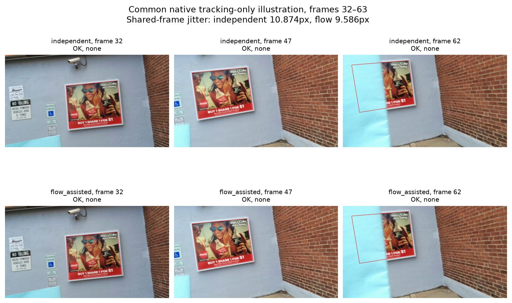
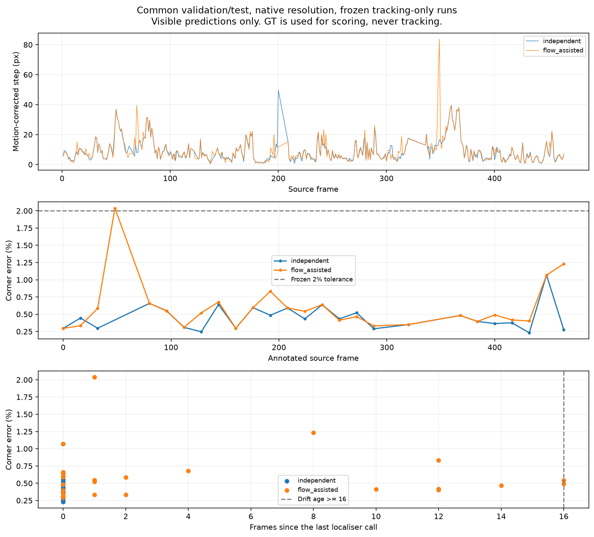
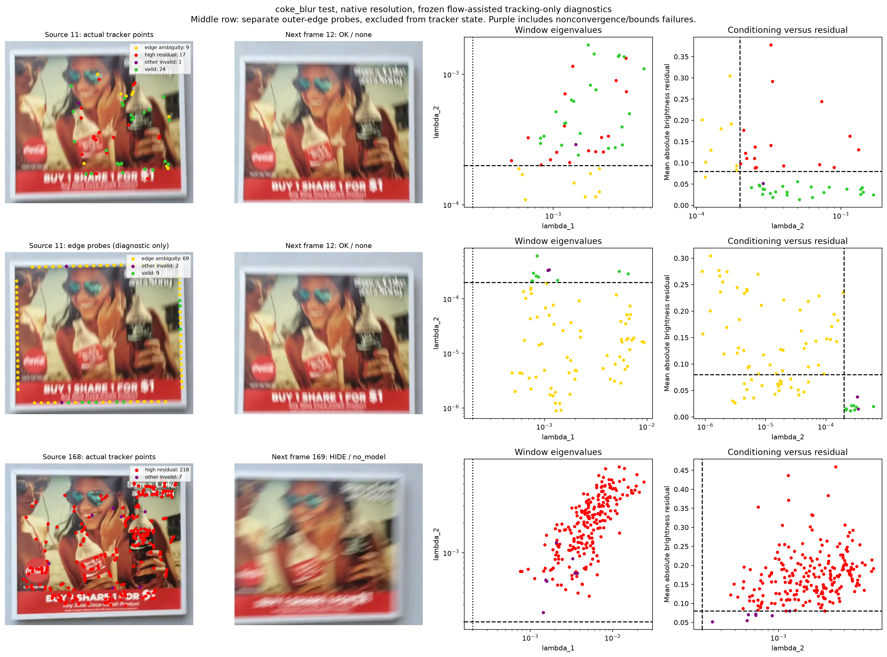
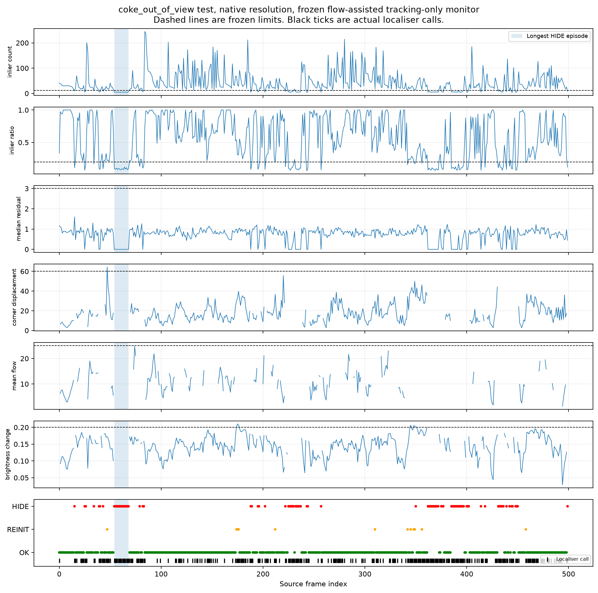
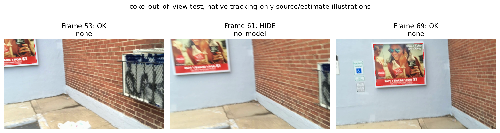
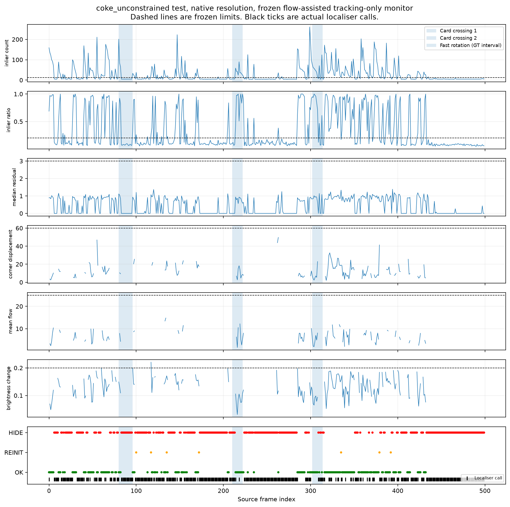
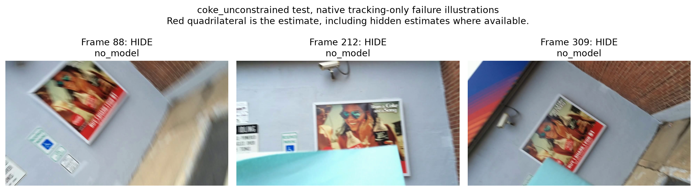

# CS4243 Lab 2 report
### Wang Ruijie (A0272335H), Sean Tham (A0282350L)

The pipeline uses feature matching and planar geometry to localise a board for perspective-aware advertisement placement. Parameters are selected on the common clip's validation frames and fixed for evaluation on its test frames and the supplied stress clips. Quantitative results use `overlaylab.metrics` and `overlaylab.evaluate`, with the clip, frame subset, processing resolution and method identified for each experiment.

## Stage 1 — Localise
### Code Explanation

#### `keypoints.py`

- `harris_response`:
  - Computes horizontal and vertical gradients using the supplied Sobel operator, then applies Gaussian smoothing to their products to construct the second-moment matrix at each pixel.
  - Calculates the Harris response as `det(M) - kappa * trace(M)^2`, producing a float32 response map with the same height and width as the grayscale image.

- `detect_corners`:
  - Removes non-positive Harris responses and responses below the configured fraction of the maximum.
  - In window NMS mode, retains responses equal to the maximum in their square neighbourhood, including ties. In radius NMS mode, greedily accepts candidates in descending response order and suppresses candidates within a circular radius.
  - After NMS, removes candidates within the configured image border. Border candidates participate in suppression before being discarded.
  - Applies the `max_corners` limit before border removal, without replenishing discarded candidates. Returns the surviving keypoints as `(x, y)` coordinates, ordered by decreasing response, together with their response values. The limit is an upper bound on the number of usable descriptors.

- `describe_keypoints`:
  - Samples gradients on a centred 16 x 16 grid at the configured patch scale. A gradient-magnitude-weighted orientation histogram determines the dominant orientation; optional Gaussian weighting gives central samples more influence.
  - Rotates the sampling grid to the dominant orientation and expresses gradient directions relative to it. The samples are accumulated into spatial-cell histograms, with each sample's magnitude distributed between neighbouring orientation bins. The standard 4 x 4 cells and 8 bins produce a 128-dimensional descriptor.
  - Normalises each descriptor to unit Euclidean norm, clamps large entries, and normalises it again. Keypoints with out-of-bounds sampling windows or zero gradient energy are discarded. Returns the descriptors and indices of the retained input keypoints.

- `match_descriptors`:
  - Computes pairwise Euclidean distances using descriptor norms and matrix multiplication, then finds the nearest and second-nearest neighbours in the second descriptor set.
  - Accepts a match when the nearest-to-second-nearest distance ratio is below the configured threshold. Ambiguous matches with a zero second-nearest distance are rejected; the optional mutual check also requires the reverse nearest-neighbour match to agree.
  - Returns accepted descriptor-index pairs, nearest-neighbour distances, and distance ratios. Returns empty arrays when there are insufficient descriptors for the ratio test.

#### `geometry.py`

- `bilinear_sample`:
  - Clamps floating-point sample coordinates to the image boundaries and identifies the four neighbouring pixels.
  - Interpolates horizontally and then vertically using the fractional coordinate offsets. Supports grayscale and colour images, with integer coordinates reproducing the corresponding pixel values.

- `normalise_points`:
  - Translates the input points so that their centroid is at the origin, then scales them so that their mean distance from the origin is `sqrt(2)` when the spread is nonzero.
  - Returns the similarity transformation and normalised points. This places coordinates on a comparable numerical scale before constructing the DLT system.

- `dlt_homography`:
  - Normalises source and destination points and constructs the `2N x 9` DLT system, with two equations per correspondence. Uses SVD to obtain the homography from the final right singular vector.
  - Denormalises the estimate using `H = inverse(T_dst) @ H_normalised @ T_src` and scales it so that `H[2, 2] = 1` when possible; otherwise, it uses the matrix norm.
  - Raises an error for fewer than four correspondences or incompatible point-array shapes. Returns a failure status for non-finite inputs, a DLT system with rank below eight, or a non-finite or singular homography. Also returns the DLT singular values for conditioning analysis.

- `transfer_points`:
  - Converts `(x, y)` points to homogeneous coordinates, applies the homography, and divides by the third coordinate to recover image coordinates.
  - Returns an `N x 2` array, leaving projections with non-finite homogeneous coordinates or a zero denominator as `NaN`. Pixel centres use integer coordinates, with `x` indexing columns and `y` indexing rows.

- `symmetric_transfer_error`:
  - Projects source points forward with `H` and destination points backward with `inverse(H)`.
  - Returns the sum of the squared forward and backward distances for each correspondence, in squared pixel units. Singular homographies and invalid projections receive infinite error.

- `ransac_homography`:
  - Uses the configured random generator to sample four correspondences without replacement. Rejects samples containing three nearly collinear points in either image, then estimates a candidate homography using normalised DLT.
  - Classifies inliers using the symmetric transfer error threshold. Selects the model with the most inliers, breaking ties using the smaller total inlier error, and reduces the iteration budget using the best inlier fraction and configured confidence.
  - Refits the homography on the best consensus set and recomputes residuals and inliers. Returns the homography, inlier mask, residuals, iteration count, and status; returns failure if the required inlier count is not met or the refit is invalid.

- `warp_artwork`:
  - Creates a grid of destination pixel centres and applies the inverse artwork-to-frame homography to find their source coordinates.
  - Marks pixels whose source coordinates fall inside the artwork, allowing a small numerical tolerance at the boundaries, and samples those pixels using `bilinear_sample`.
  - Returns the warped float32 image and Boolean coverage mask. Pixels outside coverage remain zero in the warped image.

#### `localisation.py`

- `localise_board`:
  - Converts the reference and frame to grayscale, detects and describes their keypoints, and retains only keypoints with valid descriptors. Matches the descriptors and estimates the reference-to-frame homography using RANSAC.
  - Projects the reference corners in top-left, top-right, bottom-right, bottom-left order. Returns the homography, projected corners, matches, inlier mask, and diagnostics containing feature and match counts, inlier ratio, residuals, iterations, status, and the retained keypoints.
  - Reports the median inlier residual as `median(sqrt(symmetric_error / 2))`. If estimation fails or the projected corners are invalid, returns `H = None`, `NaN` corners, and a false status.

- `artwork_to_frame`:
  - Uses the supplied rectangle-scaling helper to map the artwork's pixel rectangle onto the configured reference rectangle. If the reference shape is unset, uses the artwork's dimensions.
  - Composes this scaling with the reference-to-frame homography as `H_artwork_to_frame = H @ S_artwork_to_reference`. The scaling maps corner pixel centres using dimensions minus one, avoiding a half-pixel offset.

- `overlay_frame`:
  - Obtains the composed artwork-to-frame homography and calls `warp_artwork` to generate the warped artwork and coverage mask.
  - Copies the original frame as float32 and replaces pixels inside coverage with the warped artwork. This Stage 1 overlay does not apply an occlusion mask.

- `evaluate_audit_frames`:
  - Runs `localise_board` on each frame present in both the image and ground-truth dictionaries. Uses the supplied metrics to measure mean corner distance normalised by the longer ground-truth board diagonal.
  - Records per-frame errors, match and inlier statistics, residuals, status, and predicted corners, retaining failed localisations as infinite errors.
  - Returns the per-frame records and a summary containing the median and 90th-percentile finite error, success rate at the configured threshold, total count, and failed count. Failures remain in the success-rate denominator.

### Validation choices and frozen settings

Initial testing used the notebook defaults with radius NMS, `sigma_w=2.0` and `kappa=0.06` retained from Notebook 1's validation repeatability sweep. At **1280 × 720**, this baseline succeeded on **10/13 common validation frames**. Investigation of the three missed frames (80, 240 and 448) found only **9, 9 and 5 candidate inliers**, below the required **12**. We therefore targeted feature availability and matching: NMS radius and corner count, followed by ratio threshold and mutual checking, with interaction checks on the leading configurations. Searching all parameters jointly would take too long. Other parameters such as descriptor and RANSAC settings, sigma, kappa and NMS mode were held fixed.

All tuning used common-clip validation data. Configurations were ranked by **highest success rate**, then **fewest unavailable models**, **lowest finite p90 error**, and **lowest finite median error**, using RANSAC seed **0**. The table summarises representative trials from Notebook 1 §3.1.

| Common validation, 1280 px, independent localisation | Success at 2% | No model | Finite median error | Finite p90 error |
|---|---:|---:|---:|---:|
| baseline: 600 corners, r=5 | 10/13 | 3 | 0.379% | 0.668% |
| features: 800 corners, r=5 | 11/13 | 2 | 0.392% | 0.680% |
| features: 1000 corners, r=5 | 12/13 | 1 | 0.364% | 0.621% |
| matches: ratio=0.85, mutual=False | 13/13 | 0 | 0.486% | 0.739% |
| matches: ratio=0.85, mutual=True | 13/13 | 0 | 0.440% | 0.718% |
| matches: ratio=0.9, mutual=False (selected) | 13/13 | 0 | 0.521% | 0.655% |
| matches: ratio=0.9, mutual=True | 13/13 | 0 | 0.312% | 0.731% |

The Harris detector uses `sigma_w=2.0`, `kappa=0.06`, a response fraction of `0.005`, radius NMS with **radius 5**, a limit of **1000 corners** and a border of 12 pixels. The descriptor uses patch scale 1, 36 dominant-orientation bins, 4 × 4 × 8 histograms, Gaussian weighting and a clamp of 0.2. Matching uses **ratio 0.90** with **mutual=False**. RANSAC uses a threshold of **9 px²**, confidence 0.995, a cap of 2000 iterations, a minimum of 12 inliers and seed 0. These settings are saved in `outputs/stage1_settings.json` and `outputs/thresholds.json` before test/stress reporting.

Success means **mean corner error ≤ 2% of the longer GT board diagonal**, approximately **8.42–11.29 px** on the native validation boards. This fixed tolerance allows modest placement error above the approximately one-pixel annotation noise. Unavailable models count as failures. The median and p90 errors describe finite estimates only.

### Coordinate conventions and artwork mapping

Coordinates are `(x, y)`, where **x indexes columns and y indexes rows**. Pixel centres lie at integer coordinates from `(0, 0)` to `(w−1, h−1)`, with no half-pixel offset. Artwork placement uses `H_artwork→frame = H_reference→frame @ S_artwork→reference`. The scaling factors are `(W_ref−1)/(W_art−1)` and `(H_ref−1)/(H_art−1)` so that the artwork's corner pixel centres map to the reference corners. The inverse composed map supplies source coordinates for bilinear sampling.

### Utility routines used

Utilities used are the supplied `sobel_gradients`, `gaussian_smooth`, `to_gray`, `rect_corners`, image/video loaders and plotting helpers. The helper `rectangle_to_rectangle` supplies the pixel-centre rectangle scaling. Linear algebra uses NumPy SVD/inversion. Synthetic/GT transforms in the notebooks score correspondences only. The labelled SIFT and whole-frame-warp cells are comparisons, not assessed pipeline calls.

### Stress table (Stage 1)

| row | frames | median err | p90 err | success | inliers (median) | inlier ratio | affine median err | affine success |
|---|---|---|---|---|---|---|---|---|
| common · validation | 13 | 0.52% | 0.65% | 100% | 136 | 0.637 | 0.92% | 92% |
| common · test | 13 | 0.40% | 0.49% | 92% | 151 | 0.654 | 0.84% | 85% |
| viewpoint (coke_perspective) | 32 | 0.44% | 1.02% | 66% | 41 | 0.312 | 3.30% | 19% |
| scale (coke_scale) | 32 | 0.38% | 0.57% | 28% | 5 | 0.079 | 0.67% | 28% |

`localise_board` on every annotated frame with the frozen configuration; *affine* = 6-parameter least-squares fit to the same RANSAC inliers.

The table is generated by `overlaylab.report` using the frozen thresholds at full resolution and saved in `outputs/stress_tables.md`. It measures independent `localise_board` predictions. Both success columns include all eligible annotated frames. Median/p90 errors describe finite estimates only. The following counts distinguish an unavailable model from an estimate outside the tolerance:

| Frozen independent localisation, 1280 px | Eligible frames | No model | Total failures at 2% |
|---|---:|---:|---:|
| common · validation | 13 | 0 | 0 |
| common · test | 13 | 1 | 1 |
| viewpoint (coke_perspective) | 32 | 11 | 11 |
| scale (coke_scale) | 32 | 23 | 23 |

All 21 finite viewpoint estimates satisfy the 2% tolerance. The 11 unavailable models account for all viewpoint localisation failures.

### Inlier timeline

Dashed curves show the ratio of RANSAC inliers to accepted ratio-test matches. A high ratio alone does not establish correct board placement; corner error against annotations remains the placement measure.

### RANSAC versus all-match least squares

On the 13 common **test** frames at 1280 px, RANSAC has finite median error 0.399%, p90 0.485%, and success 12/13. DLT on all of the **same ratio-test matches** has median 101.745%, p90 336.153%, and success 0/13. Outliers receive full influence in the all-match algebraic fit; the comparison changes only the estimator. This DLT baseline is the normalised homogeneous least-squares fit, not a nonlinear reprojection-error optimiser.

### Two worst cases

- Frame **48**: error unavailable (no model); fails 2%; 9/61 inliers, ratio 0.148, median RMS one-way residual 0.698 px, 2000 RANSAC iterations; model status False.
- Frame **96**: error 0.550%; passes 2%; 223/299 inliers, ratio 0.746, median RMS one-way residual 0.799 px, 28 RANSAC iterations; model status True.

**Common-test failures at 2%: 1/13. Of the two worst cases, 1/2 pass.** The two cases have the largest corner errors among the held-out common-test frames under the frozen configuration. Residual histograms use `log10(1 + e)` to show the full range, with `e` the symmetric transfer error in px² and the frozen 9 px² cutoff marked. The 2% decision is a separate, board-normalised corner measure.

Frame 48 is visibly blurred and has only 9 candidate inliers from 61 accepted matches, below the required 12, so no model is returned. Its candidate-consensus residual does not establish a reliable board-wide homography. Frame 96 contains a card occluding the lower part of the board, but 223 inliers remain from 299 accepted matches on the visible texture. Its 0.550% corner error passes the placement tolerance. Small residuals measure agreement within the selected consensus, while annotated board corners test placement across the whole target.

### Question 1 — Matching

#### Matching-collapse examples

We matched the fixed reference image to the scale and viewpoint test clips at **640 px** using the frozen Harris detector and descriptor settings. Matching used a ratio threshold of **0.90** with `mutual=False`. The matching rate is the number of accepted matches divided by the number of reference descriptors.

| Test clip, 640 px | Case/frame | Top-edge angle | Apparent scale | Keystone proxy | Harris reference/frame descriptors | Harris matches/rate |
|---|---|---:|---:|---:|---:|---:|
| coke_perspective | best / 448 | -6.3° | 1.311 | 1.066 | 324/847 | 159 / 0.491 |
| coke_perspective | worst / 256 | 24.9° | 0.956 | 1.566 | 324/900 | 34 / 0.105 |
| coke_scale | best / 80 | 1.5° | 1.060 | 1.015 | 324/816 | 205 / 0.633 |
| coke_scale | worst / 272 | -1.6° | 0.500 | 1.024 | 324/789 | 20 / 0.062 |

The clearest collapse occurs when matching the reference to **scale frame 272**, where only **20/324 descriptors (6.17%)** produce accepted matches. The same reference produces **205/324 matches (63.3%)** on frame 80. This drop is consistent with scale sensitivity because the apparent board scale falls from 1.060 to 0.500 while the top-edge angle remains close to horizontal and the keystone proxy changes little. Apparent scale is measured as the square root of projected board area divided by reference area, so it also includes foreshortening.

Matching also deteriorates on **viewpoint frame 256**, where the rate is **10.49%**, compared with **49.1%** on frame 448. Here, the keystone proxy increases from 1.066 to 1.566 as the camera views the poster more obliquely. The proxy measures the largest opposite-edge length ratio, so its increase indicates greater perspective asymmetry. The accompanying rotation and scale changes mean that this example does not isolate perspective alone.

#### Descriptor limitations and dominant-orientation normalisation

The component that fails under scale change is the descriptor's **fixed 16 × 16 sampling support and spatial histogram grid**. This is because a fixed-size patch covers a different physical region of the poster when the board becomes smaller. The same texture then occupies different histogram cells, so corresponding locations can produce substantially different descriptors.

Dominant-orientation normalisation approximately absorbs **in-plane rotation** between the reference and frame. This is because it rotates the sampling grid and measures gradient directions relative to the dominant orientation, allowing rotated versions of the same texture to produce similar descriptors. It does **not absorb scale changes** because the sampling window remains fixed in size, so it captures different physical structures as the board becomes larger or smaller. It also does **not absorb viewpoint changes** because foreshortening, shear and keystone distort the patch in ways that cannot be corrected by a single rotation.

#### What the scale row shows with a fixed reference

The native-resolution scale row reports only **9/32 successful localisations (28%)**, with **23 unavailable models**, even though the finite median corner error is just **0.38%**. This shows that the method places the board accurately on the frames it recovers but often cannot obtain a usable model across the clip's scale changes. This is consistent with the descriptor limitation because the reference stays at a fixed size while the board's observed size changes, and the descriptor never adapts its sampling scale to compensate. The low median error therefore describes the recovered frames rather than reliable localisation across the whole scale clip.

#### Comparison with SIFT on the same pairs

The labelled SIFT comparison uses the same reference/frame pairs, processing width, ratio threshold and one-way matching policy as our method.

| Test clip, 640 px | Difficult frame | Harris acceptance rate | SIFT acceptance rate |
|---|---:|---:|---:|
| coke_perspective | 256 | 10.49% | 16.17% |
| coke_scale | 272 | 6.17% | 29.79% |

SIFT achieves a higher acceptance rate on scale frame 272, with **29.79%** compared with our **6.17%**. This is consistent with its scale selection because SIFT adapts descriptor support to the detected feature scale, allowing corresponding physical structures to be described at more comparable sizes. SIFT also improves acceptance on viewpoint frame 256, but scale and orientation normalisation do not undo general perspective deformation. These results compare complete feature pipelines because SIFT changes both detection and description. Each rate uses the method's own reference-descriptor count, and a higher acceptance rate alone does not establish that the accepted matches are geometrically correct.

#### Why the ratio test rejects both incorrect and correct matches

On common validation frame **176** at **640 px**, descriptor pair **[58, 364]** is an incorrect match that the ratio test correctly rejects. Its ratio is **0.90519**, which exceeds the acceptance threshold, and its GT-scored transfer distance is **20.03 px**. The rejection is appropriate because the nearest descriptor is both insufficiently distinctive and geometrically incorrect.

Pair **[104, 431]** is geometrically correct under the analysis criterion of a transfer distance below 4 px, since its distance is **3.39 px**. It is nevertheless rejected because its ratio is **0.900495**, just above the strict acceptance rule of **ratio < 0.90**. The figure rounds this value to 0.900. This happens because the ratio test measures how much better the nearest descriptor is than the second-nearest descriptor. Repeated letters or edges can make both neighbours similarly close even when the nearest one is correct. Ground truth labels these examples for analysis and does not select pipeline matches.

### Question 2 — Geometry

#### Why camera orbit breaks the affine model

As the camera orbits the poster, the near and far sides of the board lie at different camera depths and are projected at different scales. This causes opposite edges to converge and produces the keystone distortion visible in the viewpoint clip. A six-parameter affine transformation cannot reproduce this convergence because it preserves parallel lines and maps the rectangular reference to a parallelogram. A homography can represent the projected quadrilateral because its eight degrees of freedom include a position-dependent homogeneous denominator, allowing the apparent scale to vary across the board.

The native-resolution viewpoint table compares both models using the **same RANSAC inlier correspondences**, so differences in their fits reflect the geometric models rather than different matching inputs. The homography achieves a median corner error of **0.44%** and success on **21/32 frames**, compared with **3.30%** and **6/32 frames** for the affine model. The homography therefore fits the camera orbit more accurately when enough correspondences are available. The remaining 11 viewpoint frames have no usable homography because correspondence support is insufficient.

The plot shows that affine error generally rises as the keystone proxy increases. This is because greater perspective asymmetry requires convergence that an affine transformation cannot express. On representative frame **224**, the homography error is **1.019%**, while the affine error is **9.521%**, despite both models using identical inliers. The relationship is not strictly monotonic because feature coverage and estimation noise also affect corner placement. The plots show finite estimates, while unavailable models count as failures in both success rates.

#### Whole-frame warping and parallax

For the **640-pixel viewpoint test demonstration**, we warp frame **0** toward frame **240** using `H_b @ inverse(H_a)`. Both homographies are estimated from reference-to-frame image matches. The composition first maps frame 0 back to the reference board plane and then maps that plane into frame 240.

The board approximately aligns, but background structures at other depths remain displaced. This is because camera translation produces motion that depends on depth, whereas the fitted homography describes only points on the board's plane. Applying it to points in front of or behind that plane therefore leaves a residual shift called **parallax**. For otherwise comparable geometry, this shift generally grows with camera translation and with the point's distance from the board plane.

The difference panel includes only valid source overlap so that unobserved borders, shown in gray, are not mistaken for parallax. Differences within the overlap also include interpolation, lighting and homography-estimation errors, so not every bright pixel represents parallax alone.

#### Why parallax does not harm the overlay and when it would

Background parallax does not harm our overlay because `warp_artwork` samples the artwork only inside projected board coverage, while `overlay_frame` retains the original frame outside that coverage. We therefore do not need to align or warp the background when rendering the advertisement. The whole-frame warp above demonstrates parallax rather than reproducing the rendering procedure.

A **curved, folded or otherwise nonplanar board filmed under camera translation** would violate this assumption because different parts of the target would lie at different depths. A homography fitted to one plane could then align some target regions while leaving others displaced, causing the advertisement to slide or distort across the surface. Foreground occlusion is a separate problem handled in Stage 3.

## Stage 2 — Track
### Code Explanation

#### `lk_flow`

`lk_flow` estimates a two-dimensional translation for each sparse point using a square window, the supplied previous-frame Sobel gradients and bilinear sampling of the next frame. It normalises the structure tensor by window area and returns its two eigenvalues in descending order. This makes the smaller eigenvalue a measure of whether the window constrains motion in both directions. Each iteration solves the LK normal equations with the previous gradients held fixed, stopping when the update is smaller than the convergence tolerance or the iteration budget is exhausted.

The function returns displacements, eigenvalues, mean absolute brightness residuals and validity flags. It rejects windows with an insufficient second eigenvalue, excessive final residual, nonconvergence or an out-of-image window. Residuals and conditioning describe different failure mechanisms, which is why both are retained for diagnosis. The assessed method uses single-level LK. Optional pyramidal and learned-flow extensions are omitted.

#### `track_board`

The independent variant calls `localise_board` on every frame, so successive estimates share no tracked correspondences. The flow-assisted variant first localises from the reference, then propagates matched inlier points with `lk_flow`, drops invalid tracks and estimates a new reference-to-frame homography with RANSAC. Only the new RANSAC inliers are carried forward. Re-localisation occurs on the same frame when too few valid points remain or the homography fit fails, at every configured global frame interval, or on the next frame after a monitor warning. These calls include failed attempts and are recorded separately from monitor flags.

Both variants return per-frame homographies, projected corners, status and the supplied `_frame_stats` diagnostics. The flow-assisted variant also exposes LK points, vectors, eigenvalues, residuals and validity, while reinitialised frames store an empty flow record. Their mean-flow statistic is NaN, so gaps in the timelines denote unavailable flow rather than zero motion. Its flow-frame inlier ratio divides RANSAC inliers by valid propagated points. A localised frame instead divides inliers by accepted descriptor matches, so a change of denominator can produce a ratio jump at reinitialisation. The geometric residual is the median of `sqrt(symmetric_transfer_error / 2)` over inliers. Ground truth is used for scoring only.

#### `failure_monitor`

`failure_monitor` immediately returns HIDE with `no_model` when status is lost. Otherwise it checks inlier count before ratio, requesting REINIT for weak support and escalating to HIDE after two consecutive weak frames, including lost frames. When support passes, it checks geometric residual, projected-corner displacement, mean flow and brightness change in that order. The first value above its limit requests REINIT. NaN statistics do not fire, while an infinite statistic can exceed its limit. The method compares projected geometry rather than homography matrices, whose scale is arbitrary.

The renderer would paint OK and REINIT frames that have a usable model, while HIDE suppresses artwork. Thus REINIT is a recovery request rather than immediate hiding. The online statistics use the supplied grayscale, structure-gradient and quadrilateral helpers. Quantitative tracking summaries use `overlaylab.metrics` through `report.summarise_tracking`.

### Validation choices and frozen settings

Stage 1's final localisation settings were selected on native images, following its 640-pixel explorations. Stage 2 therefore also uses **1280 × 720** for final validation. Each trial processes consecutive common frames **0–448**, but only the **13 validation corner annotations** score parameter choices. The intervening frames provide tracking context. No common-test or stress annotations select thresholds.

The default monitor correctly localises all 13 raw validation estimates within the fixed 2% tolerance, but hides frame **80** through its inlier-ratio rule. Its ratio is **0.36709**, below 0.40, despite a raw corner error of **0.6581%**. The low-ratio run begins at frame 78 and escalates to HIDE at frame 79, which explains why the accurate frame 80 is also hidden. Other accurate validation estimates trigger ratio or brightness warnings. We therefore investigate these two monitor limits while retaining the existing flow, reinitialisation and Stage 1 settings. This targets observed monitor behaviour rather than adding an optional flow extension.

| Common validation, 1280 px | Brightness maximum | Visible success at 2% | No model | Finite median | Finite p90 | Localiser calls, frames 0–448 |
|---|---|---|---|---|---|---|
| ratio ≥ 0.40 | 0.15 | 12/13 | 0 | 0.5162% | 0.6852% | 182 |
| ratio ≥ 0.40 | 0.20 | 11/13 | 0 | 0.4657% | 0.6382% | 146 |
| ratio ≥ 0.30 | 0.15 | 13/13 | 0 | 0.5574% | 0.6840% | 181 |
| ratio ≥ 0.30 | 0.20 | 12/13 | 0 | 0.5256% | 0.6561% | 145 |
| ratio ≥ 0.20 | 0.15 | 13/13 | 0 | 0.5574% | 0.6840% | 180 |
| ratio ≥ 0.20 (selected) | 0.20 | 13/13 | 0 | 0.5855% | 0.6743% | 144 |

Configurations are ranked by highest monitor-visible success, then fewest unavailable models, lowest finite p90 error, lowest finite median error and fewest localiser calls. Exact ties retain the earlier candidate, with defaults first. The selected minimum inlier ratio is **0.20** and maximum brightness change is **0.20**. Among the three settings with 13/13 visible successes, the selected combination has p90 **0.6743%**, compared with **0.6840%** for the other two. Its median is slightly higher, but p90 has priority in the predeclared ranking. A lower finite error among surviving estimates does not compensate for hiding more validation frames. Every candidate reruns tracking because monitor warnings change subsequent localisation calls.

The table's call counts cover the 449-frame development prefix, rather than the final 500-frame runs. Notebook 2 §2.1 saves the candidate summaries, validation-frame errors and flags in `student_files/stage2/validation.json`. Full tracking caches are local development files and are excluded from version control and submission.

The remaining monitor limits are count **12**, median geometric residual **3 px**, corner displacement **60 px/frame**, mean flow **25 px/frame**, and escalation after **2** weak frames. LK retains window radius **7**, **20** iterations, minimum normalised eigenvalue **0.0002**, maximum brightness residual **0.08**, convergence tolerance **0.01 px** and one level. Inlier propagation re-localises below **20** valid points or every **60** global frames. RANSAC retains seed **0**, and Stage 1's **2% of the longer GT board diagonal** success tolerance remains unchanged. This placement tolerance allows modest error above annotation noise. Every algorithm setting is frozen in `outputs/thresholds.json` before held-out Stage 2 analysis. The Stage 1 handoff and downstream settings are preserved.

### Stress table (Stage 2)

The required final stress table is **pending Stage 3** because final supplied-clip videos are intentionally deferred until the occlusion settings are frozen. After those runs, paste the generated table unchanged and cross-check the combined monitor evidence. The following table is a **provisional native tracking-only summary**, computed with the supplied tracking-summary helper. It does not claim that videos or their evaluator reports exist.

#### Native tracking-only summary

| row | frames | median err | p90 err | success | jitter | drift (≥16 fr) | longest run | tracked | (re)localisations | REINIT flags | HIDE flags |
|---|---|---|---|---|---|---|---|---|---|---|---|
| common · validation · independent | 13 | 0.52% | 0.65% | 100% | 6.71 px | n/a | 1 | 473 | 500 | 4 | 28 |
| common · validation · flow-assisted | 13 | 0.59% | 0.67% | 100% | 6.94 px | n/a | 27 | 476 | 166 | 7 | 24 |
| common · test · independent | 13 | 0.40% | 0.49% | 92% | 6.71 px | n/a | 1 | 473 | 500 | 4 | 28 |
| common · test · flow-assisted | 13 | 0.49% | 1.15% | 92% | 6.94 px | 0.52% | 27 | 476 | 166 | 7 | 24 |
| blur (coke_blur) · flow-assisted | 32 | 0.43% | 0.56% | 9% | 4.51 px | n/a | 13 | 41 | 481 | 3 | 463 |
| exit (coke_out_of_view) · flow-assisted | 30 | 0.81% | 1.82% | 77% | 7.64 px | n/a | 15 | 414 | 290 | 12 | 93 |

Each complete run contains **500 consecutive frames**. Corner-error and success denominators are 13 eligible common annotations per split, 32 blur annotations and 30 exit annotations. Hidden or missing predictions fail success, while median and p90 describe finite visible estimates only. The following disjoint counts distinguish unavailable models, hidden finite models and visible estimates outside the tolerance.

| Native tracking row | No model | Hidden with a finite model | Visible finite error > 2% |
|---|---|---|---|
| common · validation · independent | 0 | 0 | 0 |
| common · validation · flow-assisted | 0 | 0 | 0 |
| common · test · independent | 1 | 0 | 0 |
| common · test · flow-assisted | 0 | 0 | 1 |
| blur (coke_blur) · flow-assisted | 28 | 1 | 0 |
| exit (coke_out_of_view) · flow-assisted | 4 | 1 | 2 |

Jitter, longest run, tracked count and monitor/localiser counts use the whole clip, so each common variant repeats these values across its validation and test rows. Jitter uses all retained corner annotations for that clip's interpolated motion. `tracked` counts status `ok` and can include HIDE frames. Drift uses the row's finite visible annotations at least 16 frames after the last localiser call, and n/a means no qualifying measurement rather than zero error. The longest run is the greatest interval without another localiser call.

### Question 3 — Tracking

#### Common-clip jitter and reinitialisation

Independent registration **does not jitter more** on this native common-clip run. Independent tracking has whole-clip jitter **6.713 px**, compared with **6.938 px** for flow-assisted tracking. The flow-assisted value is therefore slightly higher, contrary to the expected smoothing benefit. Their common-test success rates are **12/13** and **12/13**, respectively.

Independent registration calls the localiser **500** times, while flow assistance calls it **166** times. The flow method therefore links estimates between calls, but its frequent resets limit the length over which error can accumulate. The measured tracking passes took **268.0 s** and **110.1 s**, respectively. These single-run elapsed measurements exclude rendering and compositing. Propagating a consistent point set can reduce matching noise locally, but flow-estimation error and frequent resets can offset that benefit across the clip. Only **7** flow-assisted monitor flags request REINIT, so most of its **166** localiser calls arise from tracking recovery or the fixed interval rather than monitor requests.

The diagnostic sequence at common frames **32–63** has shared-frame jitter **10.874 px** for independent registration and **9.586 px** for flow assistance. It was selected after freezing for the largest observed reduction, using identical frame support for both variants. It illustrates a local stabilisation effect rather than replacing the whole-clip comparison. Independent matching can change its selected correspondences between frames, while short-term propagation links a consistent set, which can reduce estimate-to-estimate noise.

The GT trajectory is annotated sparsely, usually at 16-frame intervals, and is linearly interpolated for jitter. Real hand-held shake between annotations therefore remains in the motion-corrected displacement. Jitter measures both that unmodelled motion and estimator variation, so a small difference cannot be attributed entirely to overlay flicker. Each whole-clip variant also has its own visible-frame support because hiding and lost frames remove adjacent pairs.

#### Carried error and drift

Flow-assisted common-test drift is **0.517%** over **2** finite visible annotated estimates at age ≥16 frames. Both qualifying common-test measurements are exactly 16 frames old and remain below the placement tolerance, so they provide little evidence about error growth at longer ages. Its longest interval without a localiser call is **27 frames**. Independent drift is unavailable because every frame starts a new localisation.

Flow-assisted frame **48** has a finite corner error of **2.0380%**, just outside the 2% tolerance, while independent registration has no model there. The flow error is measured one frame after localisation, so this failure is not evidence of long accumulated drift. The near-threshold flow result should be read with the annotation-noise limitation. Thus the equal success counts hide different failures. A nonzero late corner error alone does not establish steadily increasing drift, since localisation error and the changing visibility of features also contribute. The age plot provides the observed relationship rather than assuming monotonic accumulation.

#### Blur: aperture ambiguity versus brightness constancy

On the blur test clip at 1280 px, flow-assisted tracking succeeds on **3/32** eligible annotations and returns status `ok` on **41/500** frames. It makes **481** localiser calls and produces **463** HIDE flags. Only three annotated frames have finite visible estimates, so the low finite error in the table describes a small recovered subset. The 481 localiser calls show that re-localisation, rather than long uninterrupted flow, dominates this clip. Propagating features alone cannot guarantee recovery when blurred images also weaken reference matching.

| coke_blur test pair, native px | Edge ambiguity | Weak texture | High residual | Other invalid | Valid |
|---|---|---|---|---|---|
| 11 → 12 (tracker inputs) | 9 | 0 | 17 | 1 | 24 |
| 11 → 12 (edge probes only) | 69 | 0 | 0 | 2 | 9 |
| 168 → 169 (tracker inputs) | 0 | 0 | 218 | 7 | 0 |

On tracker pair **11 → 12**, nine windows are edge-dominated and 24 tracks remain valid. On **168 → 169**, none of 225 tracks is valid, with 218 exceeding the residual limit despite sufficient conditioning. The sharp previous image and streaked next image show the accompanying appearance change.

A large first eigenvalue and small second eigenvalue indicate edge-dominated windows. Motion perpendicular to the edge changes intensity, but motion along it is weakly constrained, which explains the aperture ambiguity on straight board structures. When both eigenvalues are small, the window instead lacks useful texture in either direction. With a sufficiently large second eigenvalue, an excessive residual reflects a different problem: the translated previous-frame patch does not explain the next image's brightness. Motion blur mixes neighbouring texture and changes its appearance, which is consistent with a brightness-constancy violation. Failed alignment or nonconvergence can also produce high residuals, so the categories and source frames support this interpretation without isolating blur as the only cause. Purple points include other invalid cases and are not automatically labelled as brightness failures.

The first and last rows use actual tracker LK inputs. The tracker propagates mostly interior Harris features, so these points do not demonstrate ambiguity on the outer border alone. The middle row separately tracks **80** uniformly spaced outer-edge probes projected from frame 11's image-estimated homography. **69/80** have a sufficiently large first eigenvalue but a small second eigenvalue along the straight border. These probes never initialise, replenish or correct `track_board`, and no GT coordinates select them. None of the selected windows has both eigenvalues below the minimum, so the figure does not claim an observed textureless-window failure.

Retained flow records supply source positions by subtracting vectors from their stored destination points. For discarded attempts immediately after a successful localisation, the previous frame's matched inliers reconstruct the input set and LK is rerun with the frozen settings. This recovers failure evidence that `track_board` deliberately replaces with an empty record when it re-localises, without changing pipeline behaviour.

#### Exit: HIDE, REINIT and recovery

The native exit test run produces **93 HIDE flags** in **29 episodes**, **12 REINIT flags** and **290 actual localiser calls**. The longest HIDE episode spans frames **54–68**, lasting **15 frames**. The first subsequent visible prediction is frame **69**, the first OK flag is frame **69**, and the first successful retained corner annotation after the episode is frame **80**. These are distinct recovery observations because REINIT frames with a model can already be painted and corner accuracy is checked only at retained annotations.

The source frames show the poster clipped in frames 53 and 61, followed by a fully visible poster at 69. Frame 53 remains OK because a model is still supported despite partial visibility, while frame 61 is hidden after model loss. When correspondence support fails, the tracker attempts re-localisation from the reference. If that also fails, `no_model` hides the overlay immediately. Later reference-to-image matches can restore a model without any GT reset. Repeated weak inlier support can instead escalate from REINIT to HIDE. The flag sequence and the source images must be read together, since hiding signals unreliable geometry and does not by itself prove that the entire board has left the image.

#### Combined clip: first triggers at crossings and fast rotation

| Combined event, test at 1280 px | Window | First non-OK frame | Flag / trigger | Candidate inliers/matches | Other breaches |
|---|---|---|---|---|---|
| Card crossing 1 | 210–222 | 210 | HIDE / no_model | 5/50 | inlier_count, inlier_ratio |
| Card crossing 2 | 302–314 | 309 | HIDE / no_model | 7/57 | inlier_count, inlier_ratio |
| Fast rotation (GT interval) | 80–96 | 83 | HIDE / no_model | 5/67 | inlier_count, inlier_ratio |

The first card window begins with HIDE / `no_model` at frame **210**, but frame **209** was already hidden for the same reason. This does not establish a new failure at the crossing's onset. The second card window remains OK through **308**, then loses its model at **309**. During fast rotation, frame **82** is OK and **83** is HIDE / `no_model`.

In all three cases, `no_model` takes precedence over simultaneous count and ratio breaches. Each candidate consensus is below the required **12 inliers**, despite its small candidate-fit residual. Mean flow and brightness change are unavailable at these lost-model frames, so this run does not show either statistic distinguishing the two physical causes at onset.

The fast-rotation interval is selected using the largest absolute change of the annotated top-edge angle per frame between retained annotations. It identifies an explanatory window rather than the precise instantaneous onset. GT never initialises or repairs tracking. These are tracking-only results, to be checked against the later Stage 3 end-to-end run.

#### What the monitor can distinguish

A low inlier ratio alone cannot uniquely distinguish occlusion from drift. An occluder can remove or change feature appearance, while accumulated displacement errors can make propagated points geometrically inconsistent. Residual, motion and brightness histories provide additional evidence, but the monitor reports the first breached statistic in a fixed order rather than assigning a physical cause. The simultaneous-breach table therefore matters when one reported trigger masks other warnings.

With the frozen RANSAC cutoff of 9 px², an accepted inlier has a reported RMS transfer residual below sqrt(9/2), approximately 2.12 px. The monitor's 3 px median-residual limit is above that bound, so this check cannot flag an accepted consensus merely because its projected board corners are wrong. GT corner error remains an evaluation measure, not an online correction signal.

The supplied brightness statistic compares the current and previous grayscale images at the same pixel positions inside the current estimated board. It does not compensate motion. A large value can therefore arise from camera motion as well as an occluder or illumination change. A sudden appearance/support disturbance near a visible card crossing is consistent with occlusion, while geometric inconsistency during a carried track is consistent with drift, but these observations do not make the monitor an unambiguous occlusion classifier.

## Stage 3 — Composite
### Code Explanation

#### `compositing.py`

- `hysteresis`:
  - Validates that the strong and weak masks are two-dimensional and have the same shape, and that connectivity is four or eight.
  - Starts a queue at every strong pixel and visits neighbouring weak pixels until no reachable pixels remain. It returns the reached Boolean mask, leaving disconnected weak responses out.

- `compensated_difference`:
  - Within the warped reference's coverage, ranks pixels by their raw mean absolute colour difference and selects the configured best-agreeing fraction for a shared gain-and-offset fit across RGB channels.
  - Computes the mean absolute colour difference between each covered frame pixel and its gain-and-offset-compensated reference value. It returns a zero-valued map outside coverage, the fitted gain and offset, and an identity fit if coverage is empty.

- `occlusion_mask`:
  - Warps the rectified board reference into the frame with the reference-to-frame homography, then obtains the compensated colour difference inside its coverage.
  - Applies the configured strong and weak thresholds with `hysteresis`, opens the candidate mask with a disc-shaped kernel, and retains connected components meeting `min_area`. The returned mask remains inside board coverage; the difference map and each kept component's label, bounds, and area are returned for diagnosis.

- `select_difference_thresholds`:
  - Precomputes the compensated difference for each supplied frame and searches strong and weak thresholds and minimum component areas. It scores each setting by the mean mask IoU against the supplied validation masks and returns the selected configuration and a log of the candidate scores.
  - Treats scores within an absolute tolerance of `1e-12` of the best score as tied, with zero relative tolerance. Selects the strong threshold nearest the midpoint between the smallest and largest tied strong values, so repeated weak/area combinations do not bias that midpoint. Then favours weak and area values nearest the input configuration, with the smaller strong value as a final tie-breaker.

- `composite`:
  - Forms a visible-board mask from artwork coverage minus occlusion. With feathering enabled, a distance transform reduces alpha near visible-region boundaries; with feathering disabled, alpha is exactly one on visible board pixels and zero elsewhere.
  - Optionally fits a shared gain and offset to the visible artwork and frame pixels, then blends the artwork and original frame with the alpha map. It returns an RGB float32 frame and an alpha map bounded by zero and one.

### Stress table (Stage 3)
### Question 4 — Occlusion

## Stage 4 — Your clip
### Capture and audit
### Overlay Scorecard
### Generative comparison
### Question 5 — Reflection

## Evidence table
| Student file | Function | Report section | Notebook figure / table / video |
|---|---|---|---|
| keypoints.py | harris_response, detect_corners, describe_keypoints, match_descriptors | Stage 1 — Code Explanation; Validation choices; Question 1 | Notebook 1 §§3–5 and SIFT cell; ratio_rejections.png; matching_coke_*.png |
| geometry.py | bilinear_sample, normalise_points, dlt_homography, symmetric_transfer_error, ransac_homography, transfer_points, warp_artwork | Stage 1 — Code Explanation; Coordinate conventions; Estimator comparison; Question 2 | Notebook 1 §§6–8 (sanity checks); Notebook 2 §§4–6.1; native_worst_cases.png; native_ransac_vs_all.png |
| localisation.py | localise_board, artwork_to_frame, overlay_frame, evaluate_audit_frames | Stage 1 — Code Explanation; Validation choices; Stress table; Questions 1–2 | Notebook 2 §§2–6.1; native_inliers.png; native_viewpoint_overlay.png; outputs/stress_tables.md |
| temporal.py | lk_flow, track_board, failure_monitor | Stage 2 — Code Explanation, Validation choices, provisional tracking summary and Question 3 | Notebook 2 §§2.1, 7–9.3 and 10.1, student_files/stage2/validation.json, native_summary.json, native_temporal.png, blur_diagnostics.png, exit_timeline.png and combined_timeline.png. Final common-clip videos and generated stress table pending Stage 3 |
| compositing.py | hysteresis, compensated_difference, occlusion_mask, select_difference_thresholds, composite | | |

## AI-use disclosure table
| Tool / model | Affected artefacts (file, cell, figure, section) | Markers | What the tool contributed | How it was verified |
|---|---|---|---|---|
| | | [AI-CODE] [AI-DESIGN] [AI-VISION] [AI-GENERATION] [AI-LANGUAGE] [HUMAN-DATA] [HUMAN-CHECK] | | |
