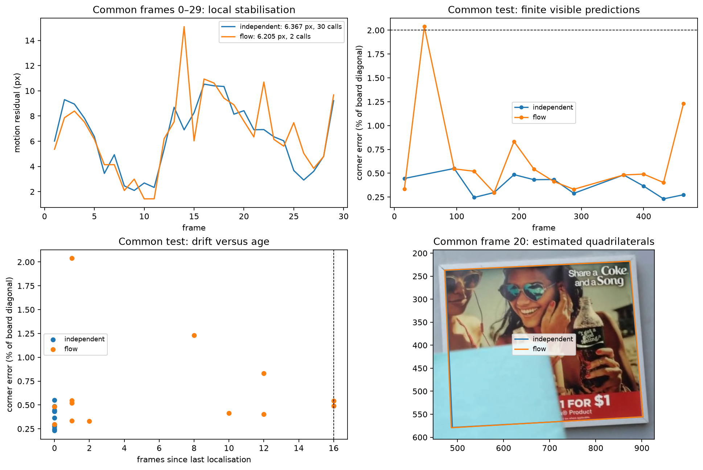
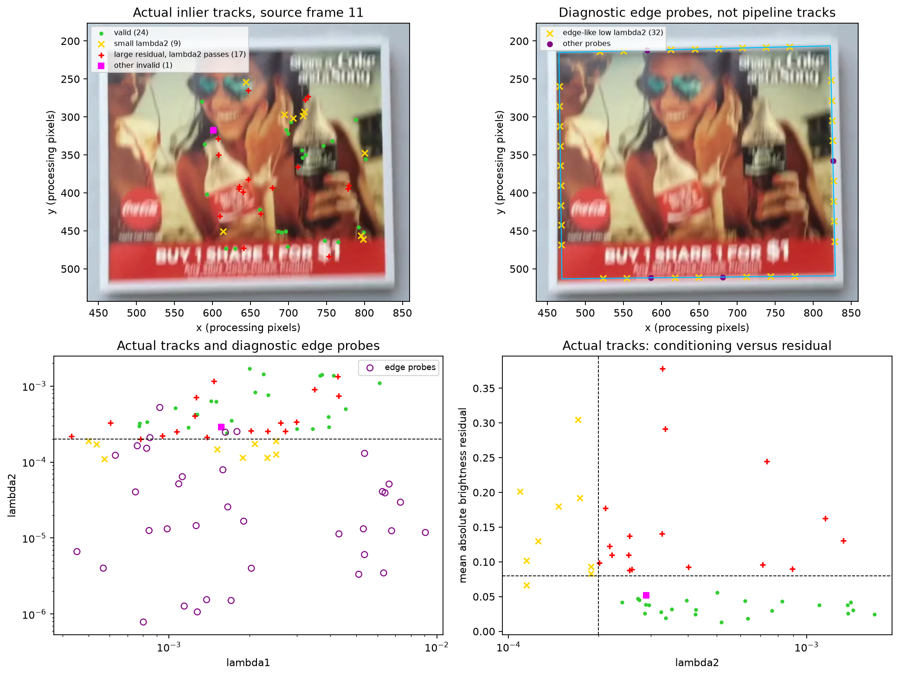
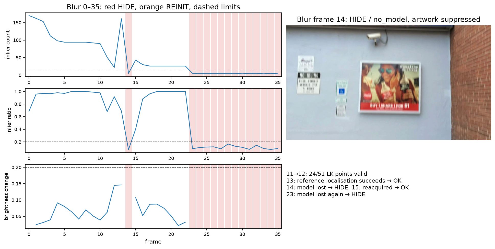
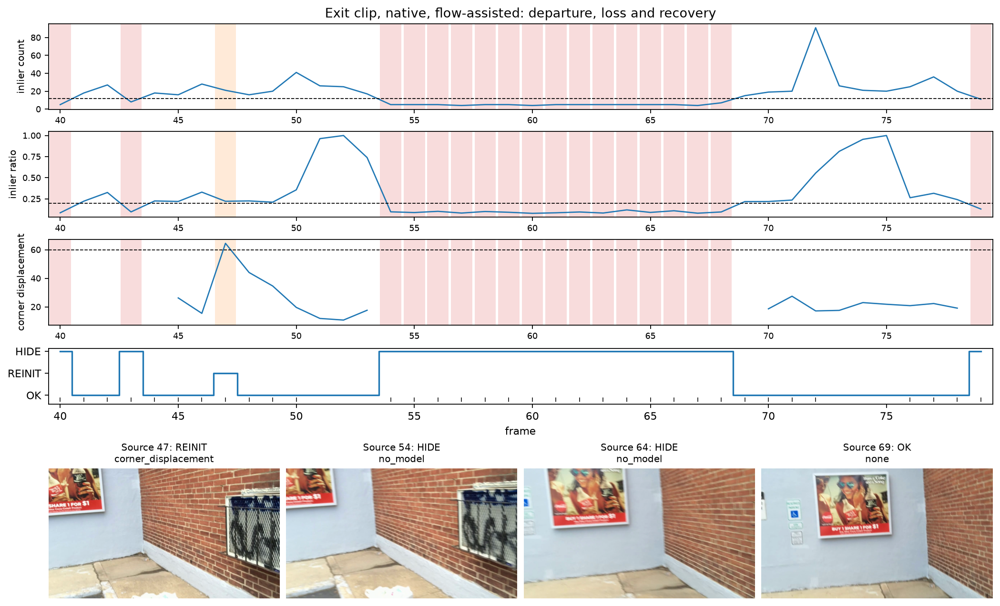
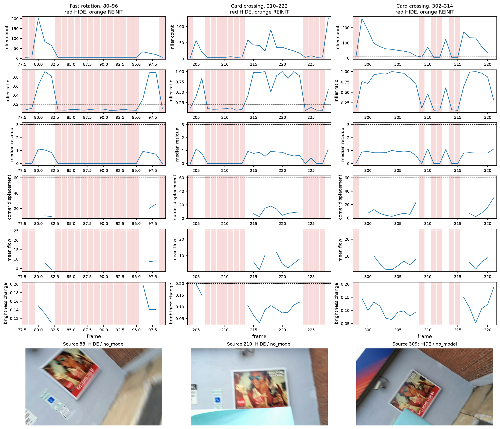
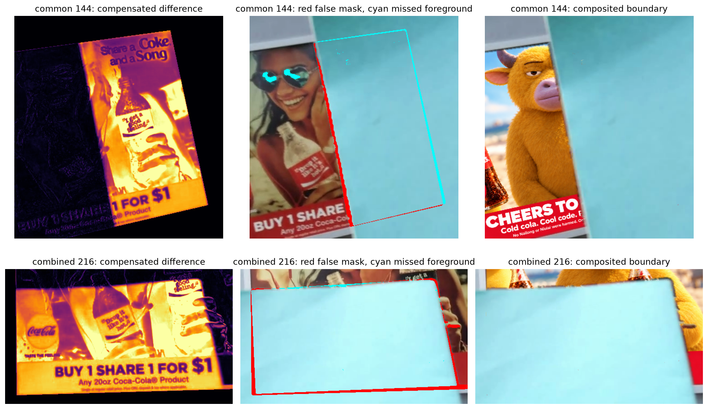
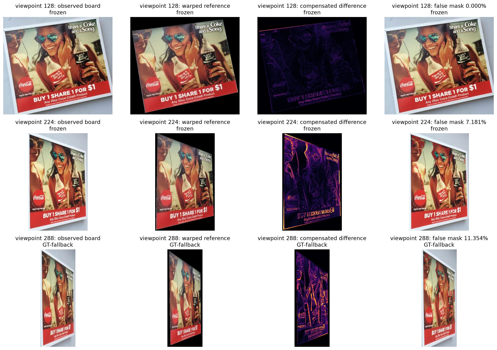

# CS4243 Lab 2 report
### Wang Ruijie (A0272335H), Sean Tham (A0282350L)

The pipeline uses feature matching and planar geometry to localise a board for perspective-aware advertisement placement. Parameters are selected on the common clip's validation frames and fixed for evaluation on its test frames and the supplied stress clips. Quantitative results use `overlaylab.metrics` and `overlaylab.evaluate`, with the clip, frame subset, processing resolution and method identified for each experiment.

## Stage 1 — Localise
### Code Explanation

#### `keypoints.py`

- `harris_response`:
  - Computes horizontal and vertical gradients using the supplied Sobel operator, then applies Gaussian smoothing to their products to construct the second-moment matrix at each pixel.
  - Calculates the Harris response as `det(M) - kappa * trace(M)^2`, producing a float32 response map with the same height and width as the grayscale image.

- `detect_corners`:
  - Removes non-positive Harris responses and responses below the configured fraction of the maximum.
  - In window NMS mode, retains responses equal to the maximum in their square neighbourhood, including ties. In radius NMS mode, greedily accepts candidates in descending response order and suppresses candidates within a circular radius.
  - After NMS, removes candidates within the configured image border. Border candidates participate in suppression before being discarded.
  - Applies the `max_corners` limit before border removal, without replenishing discarded candidates. Returns the surviving keypoints as `(x, y)` coordinates, ordered by decreasing response, together with their response values. The limit is an upper bound on the number of usable descriptors.

- `describe_keypoints`:
  - Samples gradients on a centred 16 x 16 grid at the configured patch scale. A gradient-magnitude-weighted orientation histogram determines the dominant orientation; optional Gaussian weighting gives central samples more influence.
  - Rotates the sampling grid to the dominant orientation and expresses gradient directions relative to it. The samples are accumulated into spatial-cell histograms, with each sample's magnitude distributed between neighbouring orientation bins. The standard 4 x 4 cells and 8 bins produce a 128-dimensional descriptor.
  - Normalises each descriptor to unit Euclidean norm, clamps large entries, and normalises it again. Keypoints with out-of-bounds sampling windows or zero gradient energy are discarded. Returns the descriptors and indices of the retained input keypoints.

- `match_descriptors`:
  - Computes pairwise Euclidean distances using descriptor norms and matrix multiplication, then finds the nearest and second-nearest neighbours in the second descriptor set.
  - Accepts a match when the nearest-to-second-nearest distance ratio is below the configured threshold. Ambiguous matches with a zero second-nearest distance are rejected; the optional mutual check also requires the reverse nearest-neighbour match to agree.
  - Returns accepted descriptor-index pairs, nearest-neighbour distances, and distance ratios. Returns empty arrays when there are insufficient descriptors for the ratio test.

#### `geometry.py`

- `bilinear_sample`:
  - Clamps floating-point sample coordinates to the image boundaries and identifies the four neighbouring pixels.
  - Interpolates horizontally and then vertically using the fractional coordinate offsets. Supports grayscale and colour images, with integer coordinates reproducing the corresponding pixel values.

- `normalise_points`:
  - Translates the input points so that their centroid is at the origin, then scales them so that their mean distance from the origin is `sqrt(2)` when the spread is nonzero.
  - Returns the similarity transformation and normalised points. This places coordinates on a comparable numerical scale before constructing the DLT system.

- `dlt_homography`:
  - Normalises source and destination points and constructs the `2N x 9` DLT system, with two equations per correspondence. Uses SVD to obtain the homography from the final right singular vector.
  - Denormalises the estimate using `H = inverse(T_dst) @ H_normalised @ T_src` and scales it so that `H[2, 2] = 1` when possible; otherwise, it uses the matrix norm.
  - Raises an error for fewer than four correspondences or incompatible point-array shapes. Returns a failure status for non-finite inputs, a DLT system with rank below eight, or a non-finite or singular homography. Also returns the DLT singular values for conditioning analysis.

- `transfer_points`:
  - Converts `(x, y)` points to homogeneous coordinates, applies the homography, and divides by the third coordinate to recover image coordinates.
  - Returns an `N x 2` array, leaving projections with non-finite homogeneous coordinates or a zero denominator as `NaN`. Pixel centres use integer coordinates, with `x` indexing columns and `y` indexing rows.

- `symmetric_transfer_error`:
  - Projects source points forward with `H` and destination points backward with `inverse(H)`.
  - Returns the sum of the squared forward and backward distances for each correspondence, in squared pixel units. Singular homographies and invalid projections receive infinite error.

- `ransac_homography`:
  - Uses the configured random generator to sample four correspondences without replacement. Rejects samples containing three nearly collinear points in either image, then estimates a candidate homography using normalised DLT.
  - Classifies inliers using the symmetric transfer error threshold. Selects the model with the most inliers, breaking ties using the smaller total inlier error, and reduces the iteration budget using the best inlier fraction and configured confidence.
  - Refits the homography on the best consensus set and recomputes residuals and inliers. Returns the homography, inlier mask, residuals, iteration count, and status; returns failure if the required inlier count is not met or the refit is invalid.

- `warp_artwork`:
  - Creates a grid of destination pixel centres and applies the inverse artwork-to-frame homography to find their source coordinates.
  - Marks pixels whose source coordinates fall inside the artwork, allowing a small numerical tolerance at the boundaries, and samples those pixels using `bilinear_sample`.
  - Returns the warped float32 image and Boolean coverage mask. Pixels outside coverage remain zero in the warped image.

#### `localisation.py`

- `localise_board`:
  - Converts the reference and frame to grayscale, detects and describes their keypoints, and retains only keypoints with valid descriptors. Matches the descriptors and estimates the reference-to-frame homography using RANSAC.
  - Projects the reference corners in top-left, top-right, bottom-right, bottom-left order. Returns the homography, projected corners, matches, inlier mask, and diagnostics containing feature and match counts, inlier ratio, residuals, iterations, status, and the retained keypoints.
  - Reports the median inlier residual as `median(sqrt(symmetric_error / 2))`. If estimation fails or the projected corners are invalid, returns `H = None`, `NaN` corners, and a false status.

- `artwork_to_frame`:
  - Uses the supplied rectangle-scaling helper to map the artwork's pixel rectangle onto the configured reference rectangle. If the reference shape is unset, uses the artwork's dimensions.
  - Composes this scaling with the reference-to-frame homography as `H_artwork_to_frame = H @ S_artwork_to_reference`. The scaling maps corner pixel centres using dimensions minus one, avoiding a half-pixel offset.

- `overlay_frame`:
  - Obtains the composed artwork-to-frame homography and calls `warp_artwork` to generate the warped artwork and coverage mask.
  - Copies the original frame as float32 and replaces pixels inside coverage with the warped artwork. This Stage 1 overlay does not apply an occlusion mask.

- `evaluate_audit_frames`:
  - Runs `localise_board` on each frame present in both the image and ground-truth dictionaries. Uses the supplied metrics to measure mean corner distance normalised by the longer ground-truth board diagonal.
  - Records per-frame errors, match and inlier statistics, residuals, status, and predicted corners, retaining failed localisations as infinite errors.
  - Returns the per-frame records and a summary containing the median and 90th-percentile finite error, success rate at the configured threshold, total count, and failed count. Failures remain in the success-rate denominator.

### Validation choices and frozen settings

Initial testing used the notebook defaults with radius NMS, `sigma_w=2.0` and `kappa=0.06` retained from Notebook 1's validation repeatability sweep. At **1280 × 720**, this baseline succeeded on **10/13 common validation frames**. Investigation of the three missed frames (80, 240 and 448) found only **9, 9 and 5 candidate inliers**, below the required **12**. We therefore targeted feature availability and matching: NMS radius and corner count, followed by ratio threshold and mutual checking, with interaction checks on the leading configurations. Searching all parameters jointly would take too long. Other parameters such as descriptor and RANSAC settings, sigma, kappa and NMS mode were held fixed.

All tuning used common-clip validation data. Configurations were ranked by **highest success rate**, then **fewest unavailable models**, **lowest finite p90 error**, and **lowest finite median error**, using RANSAC seed **0**. Table 1.1 summarises representative trials from Notebook 1 §3.1.

*Table 1.1. Stage 1 parameter selection on common-clip validation annotations at 1280 × 720, using independent localisation.*

| Common validation, 1280 px, independent localisation | Success at 2% | No model | Finite median error | Finite p90 error |
|---|---:|---:|---:|---:|
| baseline: 600 corners, r=5 | 10/13 | 3 | 0.379% | 0.668% |
| features: 800 corners, r=5 | 11/13 | 2 | 0.392% | 0.680% |
| features: 1000 corners, r=5 | 12/13 | 1 | 0.364% | 0.621% |
| matches: ratio=0.85, mutual=False | 13/13 | 0 | 0.486% | 0.739% |
| matches: ratio=0.85, mutual=True | 13/13 | 0 | 0.440% | 0.718% |
| matches: ratio=0.9, mutual=False (selected) | 13/13 | 0 | 0.521% | 0.655% |
| matches: ratio=0.9, mutual=True | 13/13 | 0 | 0.312% | 0.731% |

For the selected configuration in Table 1.1, the Harris detector uses `sigma_w=2.0`, `kappa=0.06`, a response fraction of `0.005`, radius NMS with **radius 5**, a limit of **1000 corners** and a border of 12 pixels. The descriptor uses patch scale 1, 36 dominant-orientation bins, 4 × 4 × 8 histograms, Gaussian weighting and a clamp of 0.2. Matching uses **ratio 0.90** with **mutual=False**. RANSAC uses a threshold of **9 px²**, confidence 0.995, a cap of 2000 iterations, a minimum of 12 inliers and seed 0. These settings are saved in `outputs/stage1_settings.json` and `outputs/thresholds.json` before test/stress reporting.

Success means **mean corner error ≤ 2% of the longer GT board diagonal**, approximately **8.42–11.29 px** on the native validation boards. This fixed tolerance allows modest placement error above the approximately one-pixel annotation noise. Unavailable models count as failures. The median and p90 errors describe finite estimates only.

### Coordinate conventions and artwork mapping

Coordinates are `(x, y)`, where **x indexes columns and y indexes rows**. Pixel centres lie at integer coordinates from `(0, 0)` to `(w−1, h−1)`, with no half-pixel offset. Artwork placement uses `H_artwork→frame = H_reference→frame @ S_artwork→reference`. The scaling factors are `(W_ref−1)/(W_art−1)` and `(H_ref−1)/(H_art−1)` so that the artwork's corner pixel centres map to the reference corners. The inverse composed map supplies source coordinates for bilinear sampling.

### Utility routines used

Utilities used are the supplied `sobel_gradients`, `gaussian_smooth`, `to_gray`, `rect_corners`, image/video loaders and plotting helpers. The helper `rectangle_to_rectangle` supplies the pixel-centre rectangle scaling. Linear algebra uses NumPy SVD/inversion. Synthetic/GT transforms in the notebooks score correspondences only. The labelled SIFT and whole-frame-warp cells are comparisons, not assessed pipeline calls.

### Stress table (Stage 1)

*Table 1.2. Generated Stage 1 stress table for the common, viewpoint and scale clips, using frozen independent localisation at 1280 × 720.*

| row | frames | median err | p90 err | success | inliers (median) | inlier ratio | affine median err | affine success |
|---|---|---|---|---|---|---|---|---|
| common · validation | 13 | 0.52% | 0.65% | 100% | 136 | 0.637 | 0.92% | 92% |
| common · test | 13 | 0.40% | 0.49% | 92% | 151 | 0.654 | 0.84% | 85% |
| viewpoint (coke_perspective) | 32 | 0.44% | 1.02% | 66% | 41 | 0.312 | 3.30% | 19% |
| scale (coke_scale) | 32 | 0.38% | 0.57% | 28% | 5 | 0.079 | 0.67% | 28% |

`localise_board` on every annotated frame with the frozen configuration; *affine* = 6-parameter least-squares fit to the same RANSAC inliers.

Table 1.2 is generated by `overlaylab.report` using the frozen thresholds at full resolution and saved in `outputs/stress_tables.md`. It measures independent `localise_board` predictions. Both success columns include all eligible annotated frames. Median/p90 errors describe finite estimates only. Table 1.3 distinguishes an unavailable model from an estimate outside the tolerance.

*Table 1.3. Additional summary of unavailable models and failures at the 2% tolerance for frozen independent localisation at 1280 × 720.*

| Frozen independent localisation, 1280 px | Eligible frames | No model | Total failures at 2% |
|---|---:|---:|---:|
| common · validation | 13 | 0 | 0 |
| common · test | 13 | 1 | 1 |
| viewpoint (coke_perspective) | 32 | 11 | 11 |
| scale (coke_scale) | 32 | 23 | 23 |

Table 1.3 shows that the 11 unavailable models account for all viewpoint localisation failures. All 21 finite viewpoint estimates satisfy the 2% tolerance.

### Inlier timeline

*Figure 1.1. Common-clip validation and test inlier counts and ratios at 1280 × 720, using frozen independent localisation.*

In Figure 1.1, dashed curves show the ratio of RANSAC inliers to accepted ratio-test matches. A high ratio alone does not establish correct board placement. Corner error against annotations remains the placement measure.

### RANSAC versus all-match least squares

Figure 1.2 compares estimators on the 13 common **test** frames at 1280 px. RANSAC has finite median error 0.399%, p90 0.485%, and success 12/13. DLT on all of the **same ratio-test matches** has median 101.745%, p90 336.153%, and success 0/13. Outliers receive full influence in the all-match algebraic fit, and the comparison changes only the estimator. This DLT baseline is the normalised homogeneous least-squares fit, not a nonlinear reprojection-error optimiser.

*Figure 1.2. RANSAC versus all-match DLT on common-test annotations at 1280 × 720, using the same ratio-test correspondences.*

### Two worst cases

*Figure 1.3. The two worst common-test localisation cases at 1280 × 720: matches, finite residuals and annotated/predicted quadrilaterals on frames 48 and 96.*

- Frame **48**: error unavailable (no model); fails 2%; 9/61 inliers, ratio 0.148, median RMS one-way residual 0.698 px, 2000 RANSAC iterations; model status False.
- Frame **96**: error 0.550%; passes 2%; 223/299 inliers, ratio 0.746, median RMS one-way residual 0.799 px, 28 RANSAC iterations; model status True.

**Common-test failures at 2%: 1/13 (Table 1.3). Of the two worst cases, 1/2 pass (Figure 1.3).** The two cases have the largest corner errors among the held-out common-test frames under the frozen configuration. The residual histograms in Figure 1.3 use `log10(1 + e)` to show the full range, with `e` the symmetric transfer error in px² and the frozen 9 px² cutoff marked. The 2% decision is a separate, board-normalised corner measure.

In Figure 1.3, frame 48 is visibly blurred and has only 9 candidate inliers from 61 accepted matches, below the required 12, so no model is returned. Its candidate-consensus residual does not establish a reliable board-wide homography. Frame 96 contains a card occluding the lower part of the board, but 223 inliers remain from 299 accepted matches on the visible texture. Its 0.550% corner error passes the placement tolerance. Small residuals measure agreement within the selected consensus, while annotated board corners test placement across the whole target.

### Question 1 — Matching

#### Matching-collapse examples

We matched the fixed reference image to the scale and viewpoint test clips at **640 px** using the frozen Harris detector and descriptor settings. Matching used a ratio threshold of **0.90** with `mutual=False`. The matching rate is the number of accepted matches divided by the number of reference descriptors.

*Figure 1.4. Best and worst reference/frame matching examples on the scale test clip at 640 px, using the frozen Harris descriptor.*

*Figure 1.5. Best and worst reference/frame matching examples on the viewpoint test clip at 640 px, using the frozen Harris descriptor.*

*Table 1.4. Geometry and matching statistics for the scale and viewpoint examples in Figures 1.4 and 1.5, using the frozen Harris descriptor at 640 px.*

| Test clip, 640 px | Case/frame | Top-edge angle | Apparent scale | Keystone proxy | Harris reference/frame descriptors | Harris matches/rate |
|---|---|---:|---:|---:|---:|---:|
| coke_perspective | best / 448 | -6.3° | 1.311 | 1.066 | 324/847 | 159 / 0.491 |
| coke_perspective | worst / 256 | 24.9° | 0.956 | 1.566 | 324/900 | 34 / 0.105 |
| coke_scale | best / 80 | 1.5° | 1.060 | 1.015 | 324/816 | 205 / 0.633 |
| coke_scale | worst / 272 | -1.6° | 0.500 | 1.024 | 324/789 | 20 / 0.062 |

The clearest collapse occurs when matching the reference to **scale frame 272** in Figure 1.4 and Table 1.4, where only **20/324 descriptors (6.17%)** produce accepted matches. The same reference produces **205/324 matches (63.3%)** on frame 80. This drop is consistent with scale sensitivity because the apparent board scale falls from 1.060 to 0.500 while the top-edge angle remains close to horizontal and the keystone proxy changes little. Apparent scale is measured as the square root of projected board area divided by reference area, so it also includes foreshortening.

Figure 1.5 and Table 1.4 also show deterioration on **viewpoint frame 256**, where the rate is **10.49%**, compared with **49.1%** on frame 448. Here, the keystone proxy increases from 1.066 to 1.566 as the camera views the poster more obliquely. The proxy measures the largest opposite-edge length ratio, so its increase indicates greater perspective asymmetry. The accompanying rotation and scale changes mean that this example does not isolate perspective alone.

#### Descriptor limitations and dominant-orientation normalisation

The component that fails under scale change is the descriptor's **fixed 16 × 16 sampling support and spatial histogram grid**. This is because a fixed-size patch covers a different physical region of the poster when the board becomes smaller. The same texture then occupies different histogram cells, so corresponding locations can produce substantially different descriptors.

Dominant-orientation normalisation approximately absorbs **in-plane rotation** between the reference and frame. This is because it rotates the sampling grid and measures gradient directions relative to the dominant orientation, allowing rotated versions of the same texture to produce similar descriptors. It does **not absorb scale changes** because the sampling window remains fixed in size, so it captures different physical structures as the board becomes larger or smaller. It also does **not absorb viewpoint changes** because foreshortening, shear and keystone distort the patch in ways that cannot be corrected by a single rotation.

#### What the scale row shows with a fixed reference

The native-resolution scale row in Table 1.2 reports only **9/32 successful localisations (28%)** and finite median corner error **0.38%**, while Table 1.3 identifies **23 unavailable models**. This shows that the method places the board accurately on the frames it recovers but often cannot obtain a usable model across the clip's scale changes. This is consistent with the descriptor limitation because the reference stays at a fixed size while the board's observed size changes, and the descriptor never adapts its sampling scale to compensate. The low median error therefore describes the recovered frames rather than reliable localisation across the whole scale clip.

#### Comparison with SIFT on the same pairs

The labelled SIFT comparison in Table 1.5 uses the same reference/frame pairs, processing width, ratio threshold and one-way matching policy as our method.

*Table 1.5. Harris and SIFT descriptor-acceptance rates on the same difficult viewpoint and scale test pairs at 640 px.*

| Test clip, 640 px | Difficult frame | Harris acceptance rate | SIFT acceptance rate |
|---|---:|---:|---:|
| coke_perspective | 256 | 10.49% | 16.17% |
| coke_scale | 272 | 6.17% | 29.79% |

Table 1.5 shows a higher acceptance rate for SIFT on scale frame 272, with **29.79%** compared with our **6.17%**. This is consistent with its scale selection because SIFT adapts descriptor support to the detected feature scale, allowing corresponding physical structures to be described at more comparable sizes. SIFT also improves acceptance on viewpoint frame 256, but scale and orientation normalisation do not undo general perspective deformation. These results compare complete feature pipelines because SIFT changes both detection and description. Each rate uses the method's own reference-descriptor count, and a higher acceptance rate alone does not establish that the accepted matches are geometrically correct.

#### Why the ratio test rejects both incorrect and correct matches

*Figure 1.6. Ratio-test rejection examples on common validation frame 176 at 640 px, using the frozen descriptor and GT-scored transfer distances for analysis.*

In Figure 1.6, on common validation frame **176** at **640 px**, descriptor pair **[58, 364]** is an incorrect match that the ratio test correctly rejects. Its ratio is **0.90519**, which exceeds the acceptance threshold, and its GT-scored transfer distance is **20.03 px**. The rejection is appropriate because the nearest descriptor is both insufficiently distinctive and geometrically incorrect.

Pair **[104, 431]** in Figure 1.6 is geometrically correct under the analysis criterion of a transfer distance below 4 px, since its distance is **3.39 px**. It is nevertheless rejected because its ratio is **0.900495**, just above the strict acceptance rule of **ratio < 0.90**. Figure 1.6 rounds this value to 0.900. This happens because the ratio test measures how much better the nearest descriptor is than the second-nearest descriptor. Repeated letters or edges can make both neighbours similarly close even when the nearest one is correct. Ground truth labels these examples for analysis and does not select pipeline matches.

### Question 2 — Geometry

#### Why camera orbit breaks the affine model

As the camera orbits the poster, the near and far sides of the board lie at different camera depths and are projected at different scales. This causes opposite edges to converge and produces the keystone distortion visible in the viewpoint clip. A six-parameter affine transformation cannot reproduce this convergence because it preserves parallel lines and maps the rectangular reference to a parallelogram. A homography can represent the projected quadrilateral because its eight degrees of freedom include a position-dependent homogeneous denominator, allowing the apparent scale to vary across the board.

The native-resolution viewpoint row of Table 1.2 compares both models using the **same RANSAC inlier correspondences**, so differences in their fits reflect the geometric models rather than different matching inputs. The homography achieves a median corner error of **0.44%** and success on **21/32 frames**, compared with **3.30%** and **6/32 frames** for the affine model. The homography therefore fits the camera orbit more accurately when enough correspondences are available. Table 1.3 identifies the remaining 11 viewpoint frames as unavailable models because correspondence support is insufficient.

*Figure 1.7. Frozen homography and affine corner errors over viewpoint-test frames and against the keystone proxy at 1280 × 720, using identical RANSAC inliers.*

Figure 1.7 shows that affine error generally rises as the keystone proxy increases. This is because greater perspective asymmetry requires convergence that an affine transformation cannot express. On representative frame **224**, illustrated in Figure 1.8, the homography error is **1.019%**, while the affine error is **9.521%**, despite both models using identical inliers. The relationship is not strictly monotonic because feature coverage and estimation noise also affect corner placement. Figure 1.7 shows finite estimates, while unavailable models count as failures in both success rates in Table 1.2.

*Figure 1.8. Annotated, homography and affine quadrilaterals on viewpoint-test frame 224 at 1280 × 720, with the single-frame artwork overlay.*

#### Whole-frame warping and parallax

For the **640-pixel viewpoint test demonstration in Figure 1.9**, we warp frame **0** toward frame **240** using `H_b @ inverse(H_a)`. Both homographies are estimated from reference-to-frame image matches. The composition first maps frame 0 back to the reference board plane and then maps that plane into frame 240.

*Figure 1.9. Viewpoint-test parallax demonstration at 640 px, warping frame 0 toward frame 240 with frozen estimated homographies: target, whole-frame board-plane warp and absolute difference.*

In Figure 1.9, the board approximately aligns, but background structures at other depths remain displaced. This is because camera translation produces motion that depends on depth, whereas the fitted homography describes only points on the board's plane. Applying it to points in front of or behind that plane therefore leaves a residual shift called **parallax**. For otherwise comparable geometry, this shift generally grows with camera translation and with the point's distance from the board plane.

The difference panel in Figure 1.9 includes only valid source overlap so that unobserved borders, shown in gray, are not mistaken for parallax. Differences within the overlap also include interpolation, lighting and homography-estimation errors, so not every bright pixel represents parallax alone.

#### Why parallax does not harm the overlay and when it would

Background parallax does not harm our overlay because `warp_artwork` samples the artwork only inside projected board coverage, while `overlay_frame` retains the original frame outside that coverage. We therefore do not need to align or warp the background when rendering the advertisement. The whole-frame warp in Figure 1.9 demonstrates parallax rather than reproducing the rendering procedure.

A **curved, folded or otherwise nonplanar board filmed under camera translation** would violate this assumption because different parts of the target would lie at different depths. A homography fitted to one plane could then align some target regions while leaving others displaced, causing the advertisement to slide or distort across the surface. Foreground occlusion is a separate problem handled in Stage 3.

## Stage 2 — Track
### Code Explanation

#### `temporal.py`

- `lk_flow`:
  - Estimates a two-dimensional translation for each sparse point using a square window, the supplied previous-frame Sobel gradients and bilinear sampling of the next frame.
  - Normalises the structure tensor by window area and returns its two eigenvalues in descending order. The smaller eigenvalue measures whether the window constrains motion in both directions.
  - Solves the LK normal equations iteratively with the previous gradients held fixed, stopping when the update is smaller than the convergence tolerance or the iteration budget is exhausted.
  - Returns displacements, eigenvalues, mean absolute brightness residuals and validity flags. Rejects windows with an insufficient second eigenvalue, excessive final residual, nonconvergence or an out-of-image window. Residuals and conditioning describe different failure mechanisms, so both are retained for diagnosis. The assessed method uses single-level LK, with optional pyramidal and learned-flow extensions omitted.

- `track_board`:
  - Runs `localise_board` on every frame for the independent variant, so successive estimates share no tracked correspondences.
  - For the flow-assisted variant, first localises from the reference, then propagates matched inlier points with `lk_flow`, drops invalid tracks and estimates a new reference-to-frame homography with RANSAC. Only the new RANSAC inliers are carried forward.
  - Re-localises on the same frame when too few valid points remain or the homography fit fails, at every configured global frame interval, or on the next frame after a monitor warning. Records these calls, including failed attempts, separately from monitor flags.
  - Returns per-frame homographies, projected corners, status and the supplied `_frame_stats` diagnostics. The flow-assisted variant also exposes LK points, vectors, eigenvalues, residuals and validity. Reinitialised frames store an empty flow record and have a NaN mean-flow statistic, indicating unavailable flow rather than zero motion.
  - Calculates the flow-frame inlier ratio as RANSAC inliers divided by valid propagated points. Localised frames instead divide inliers by accepted descriptor matches, so the denominator change can produce a ratio jump at reinitialisation. Reports the median of `sqrt(symmetric_transfer_error / 2)` over inliers as the geometric residual. Ground truth is used for scoring only.

- `failure_monitor`:
  - Immediately returns HIDE with `no_model` when status is lost. Otherwise checks inlier count before ratio, requesting REINIT for weak support and escalating to HIDE after two consecutive weak frames, including lost frames.
  - When support passes, checks geometric residual, projected-corner displacement, mean flow and brightness change in that order. The first value above its limit requests REINIT. NaN statistics do not fire, while an infinite statistic can exceed its limit.
  - Compares projected geometry rather than homography matrices, whose scale is arbitrary. The renderer paints OK and REINIT frames that have a usable model, while HIDE suppresses artwork, so REINIT requests recovery without immediately hiding the overlay.

The online statistics use the supplied grayscale, structure-gradient and quadrilateral helpers. Quantitative tracking summaries use `overlaylab.metrics` through `report.summarise_tracking`.

### Validation choices and frozen settings

Initial testing used the default Stage 2 settings with Stage 1's frozen localiser at **1280 × 720**. The tracker produced raw estimates within the 2% tolerance on all **13 common validation annotations**, but the monitor hid frame **80** because its inlier ratio was **0.3671**, below 0.40, despite a corner error of **0.6581%**. Other accurate estimates triggered ratio or brightness warnings. We therefore targeted these two monitor limits, holding Stage 1, LK and reinitialisation settings fixed.

All tuning used common-clip validation annotations. Each candidate tracked consecutive frames **0–448** for temporal context, but only the 13 validation annotations scored parameter choices. Configurations were ranked by **highest monitor-visible success**, then **fewest unavailable models**, **lowest finite p90 error**, **lowest finite median error**, and **fewest localiser calls**, using RANSAC seed **0**. Exact ties retained the earlier candidate, with defaults first. Table 2.1 summarises the six trials saved by Notebook 2 §2.1 in `student_files/stage2/validation.json`. Each trial reran tracking because monitor warnings affect subsequent localisation calls. Call counts cover this 449-frame prefix.

*Table 2.1. Stage 2 monitor selection on common-clip validation annotations at 1280 × 720.*

| Common validation, 1280 px, flow-assisted | Visible success at 2% | No model | Finite median error | Finite p90 error | Localiser calls |
|---|---:|---:|---:|---:|---:|
| baseline: ratio ≥ 0.40, brightness ≤ 0.15 | 12/13 | 0 | 0.5162% | 0.6852% | 182 |
| ratio ≥ 0.40, brightness ≤ 0.20 | 11/13 | 0 | 0.4657% | 0.6382% | 146 |
| ratio ≥ 0.30, brightness ≤ 0.15 | 13/13 | 0 | 0.5574% | 0.6840% | 181 |
| ratio ≥ 0.30, brightness ≤ 0.20 | 12/13 | 0 | 0.5256% | 0.6561% | 145 |
| ratio ≥ 0.20, brightness ≤ 0.15 | 13/13 | 0 | 0.5574% | 0.6840% | 180 |
| ratio ≥ 0.20, brightness ≤ 0.20 (selected) | 13/13 | 0 | 0.5855% | 0.6743% | 144 |

The monitor's minimum inlier ratio changes from **0.40 to 0.20** and its maximum brightness change from **0.15 to 0.20**. In Table 2.1, the selected pair has the lowest p90 among the three configurations with 13/13 visible successes, which takes priority over its slightly higher median. The remaining monitor limits stay at count **12**, geometric residual **3 px**, corner displacement **60 px/frame**, mean flow **25 px/frame**, and escalation after **2** weak frames. LK retains window radius **7**, **20** iterations, minimum normalised eigenvalue **0.0002**, maximum brightness residual **0.08**, convergence tolerance **0.01 px** and one level. Inlier propagation re-localises below **20** valid points or every **60** global frames. All settings and seed **0** are frozen in `outputs/thresholds.json` before test/stress reporting.

Success retains Stage 1's **mean corner error ≤ 2% of the longer GT board diagonal**, allowing modest placement error above annotation noise. Hidden or unavailable predictions count as failures, while median and p90 describe finite visible estimates only. No common-test or stress annotations select settings.

### Stress table (Stage 2)

*Table 2.2. Generated Stage 2 stress table for the common, blur and exit clips, using frozen settings at 1280 × 720.*

| row | frames | median err | p90 err | success | jitter | drift (≥16 fr) | longest run | tracked | (re)localisations | REINIT flags | HIDE flags |
|---|---|---|---|---|---|---|---|---|---|---|---|
| common · validation · independent | 13 | 0.52% | 0.65% | 100% | 6.71 px | n/a | 1 | 473 | 500 | 4 | 28 |
| common · validation · flow-assisted | 13 | 0.59% | 0.67% | 100% | 6.94 px | n/a | 27 | 476 | 166 | 7 | 24 |
| common · test · independent | 13 | 0.40% | 0.49% | 92% | 6.71 px | n/a | 1 | 473 | 500 | 4 | 28 |
| common · test · flow-assisted | 13 | 0.49% | 1.15% | 92% | 6.94 px | 0.52% | 27 | 476 | 166 | 7 | 24 |
| blur (coke_blur) · flow-assisted | 32 | 0.43% | 0.56% | 9% | 4.51 px | n/a | 13 | 41 | 481 | 3 | 463 |
| exit (coke_out_of_view) · flow-assisted | 30 | 0.81% | 1.82% | 77% | 7.64 px | n/a | 15 | 414 | 290 | 12 | 93 |

From the `_stats.json` of each run. Jitter uses the full available corner trajectory for motion interpolation. Jitter, longest run, tracked and the counts are whole-clip statistics (identical in validation and test rows for a variant); (re)localisations counts actual localiser calls, whereas REINIT/HIDE count monitor flags; drift = median corner error on the row's annotated frames at least 16 frames after the last (re)initialisation (n/a when no track is carried that long: the independent variant reinitialises every frame); longest run = most consecutive frames without a (re)initialisation.

The table and generated note above are copied unchanged from `outputs/stress_tables.md`, using final **500-frame, 1280 × 720, 30 fps** runs. Success counts hidden or unavailable predictions as failures, while median and p90 describe finite visible estimates. `Tracked` counts status `ok`, including monitor-hidden frames. Jitter uses consecutive visible pairs within the annotated span, common frames **0–464**, with all annotations supplying motion interpolation.

### Question 3 — Tracking

#### Common-clip jitter

Independent registration does **not** jitter more on the common clip. The Stage 2 stress table (Table 2.2) reports whole-clip jitter of **6.71 px**, compared with **6.94 px** for flow-assisted registration. Linking features can reduce independent matching noise, but imperfect flow and changes in correspondence support can offset that benefit. Our comparison is consistent with these mechanisms without isolating their effects. Both values also include hand-held motion not captured by the sparse ground-truth interpolation.

Both methods succeed on **12/13 common test annotations**, shown as 92% in Table 2.2. Figure 2.1 (upper right) shows their finite test errors. At frame 48, independent registration has no model, while flow returns an estimate with **2.038%** error, just above the 2% tolerance. Table 2.2 also gives higher finite median/p90 errors for flow, **0.49%/1.15%** versus **0.40%/0.49%**. Therefore, improved model availability does not necessarily improve acceptable placement.

#### Flow-assisted drift

The common run shows **small placement errors on carried tracks, but does not establish accumulated drift**. Table 2.2 reports test drift of **0.52%**, or **0.517%** before rounding. Figure 2.1 (lower left) shows the two qualifying errors, **0.543%** and **0.491%** at age 16, identified as frames **224** and **400** in Notebook 2 §10.2. This measures error at sufficient track age, not error growth. Only two test annotations qualify and Table 2.2 gives a longest carried run of **27 frames**, so frequent re-localisation limits both accumulation and evidence of long-term drift. Validation drift is unavailable because no visible validation annotation has a track age of at least 16 frames. Independent drift is unavailable because every frame is re-localised.

#### Reinitialisation cost and processing time

Flow's main benefit is **reduced localisation work**: Table 2.2 records **166 calls** versus independent registration's **500**, including initialisation and failed attempts. Its **7 REINIT / 24 HIDE flags** differ from the call count because low point support, RANSAC failure and periodic refresh also cause localisation. Independent registration records **4 REINIT / 28 HIDE flags**. The saved tracking passes, printed in Notebook 2 §10.1, took **62.13 s** for flow and **151.50 s** for independent registration, including frame loading. These single-run timings support a speed benefit, alongside slightly worse whole-clip jitter and test placement errors.

#### A stabilisation sequence on shared common-clip frames

Flow provides **modest local stabilisation on common frames 0–29**. Figure 2.1 (upper left) reports jitter of **6.205 px** versus **6.367 px** for independent registration, with **2** localiser calls instead of **30**. Both variants have 30 visible predictions and the same 29 consecutive evaluation pairs. The small improvement is consistent with carrying correspondences between frames. This illustration was selected after freezing and does not overturn the whole-clip result in Table 2.2.

*Figure 2.1. Common-clip tracking at 1280 × 720. Upper left: local jitter comparison on frames 0–29. Upper right: finite common-test corner errors. Lower left: common-test error against track age. Lower right: estimated frame-20 quadrilaterals.*

#### Blur: aperture ambiguity, brightness constancy and point locations

**Large lambda1 with small lambda2 indicates aperture ambiguity, while sufficient lambda2 with a large residual indicates a brightness mismatch despite adequate texture.** A straight edge constrains motion across the edge but not along it. If both eigenvalues are small, the window instead lacks texture in both directions. Adequate eigenvalues do not ensure brightness constancy when blur changes local appearance.

Figure 2.2 shows actual flow-assisted tracks on blur frames **11 → 12**, where **24/51** points remain valid. Nine have lambda1 ≥ **0.0002** but lambda2 below it, mainly on locally edge-like poster texture. Another 17 have sufficient lambda2 but residual > **0.08**, across the face, lettering and bottle regions. One other invalid point is shown separately. These spatial and eigenvalue measurements distinguish conditioning failures from high-residual failures, although misalignment or an incorrect local solution can also cause a large residual.

The actual tracks lie mainly inside the poster. To demonstrate the outer straight edges separately, Notebook 2 §10.3 applies the same `lk_flow` to **36 diagnostic probes** on the predicted frame-11 quadrilateral. Figure 2.2 (upper right and lower left) shows **32/36** with large lambda1 and small lambda2 along the top, bottom and sides. These labelled probes supplement the actual-track evidence and never enter tracking, videos or stress-table predictions. Their positions do not use ground truth.

*Figure 2.2. Blur-clip LK diagnostics at 1280 × 720 for frames 11 → 12. Upper left: actual track locations. Upper right: separate diagnostic edge probes. Lower left: both eigenvalues. Lower right: actual-track brightness residual against the second eigenvalue.*

#### A blur failure sequence and its effect on availability

**Flow-assisted tracking fails to maintain the overlay through persistent blur.** Figure 2.3 shows the failure sequence on frames **11–24**: inlier support falls from 51 to 22, followed by successful reference localisation at 13, loss at **14**, recovery at **15**, and renewed loss at **23**. HIDE suppresses artwork when no model is available, as the submitted frame-14 output shows.

The blur row of Table 2.2 records **481 localiser calls**, yet only **41 status-ok frames**, **463 HIDE flags** and **3/32 successful test annotations**. Therefore, the **0.43% finite median error** describes the few visible recovered estimates, not reliable tracking. Repeated localisation cannot consistently recover support from blurred appearance. The longest carried run is 13 frames, leaving drift unavailable.

*Figure 2.3. Blur-clip failure at 1280 × 720. The monitor timeline covers frames 0–35, and the submitted frame-14 output shows artwork suppressed by HIDE.*

#### Exit: HIDE, REINIT and reference-based recovery

**The exit sequence shows hiding during loss and recovery through reference matching without ground truth.** In Figure 2.4, covering frames **40–79**, frame **47** requests REINIT because corner displacement is **64.46 px**, above the 60 px limit. Failed reference localisation then produces **HIDE / no_model at 54–68**, with another attempt on every frame. The board is visible again at 64 but is not reacquired until **69**, showing that visibility alone does not ensure reliable correspondences.

At 69, **15 inliers** and ratio **0.2174** pass the monitor's count and ratio limits, returning directly to **OK**, as detailed in Notebook 2 §10.4. Recovery therefore need not produce a REINIT flag. Localisation at 70–72 rebuilds support and flow resumes at 73. The exit row of Table 2.2 gives **290 calls**, **12 REINIT flags**, **93 HIDE flags** and **23/30 successful annotations**. Five annotations are hidden/unavailable and two have finite errors above 2%. The longest carried run is 15 frames, so unavailable drift does not establish drift-free tracking.

*Figure 2.4. Exit-clip monitor timeline at 1280 × 720 on frames 40–79, with actual localiser-call ticks and source images showing departure and recovery.*

#### Combined clip: first triggers at card crossings and fast rotation

**The first recorded trigger at the selected rotation and crossing losses is `no_model`, producing HIDE.** Table 2.3 identifies the flag transitions and Figure 2.5 plots the monitor inputs from the final flow-assisted combined run at **1280 × 720**. Model loss takes precedence over numerical monitor checks, with no preceding flow or brightness warning at these losses.

*Table 2.3. First recorded failures and recovery around the selected combined-clip events, using the frozen flow-assisted run at 1280 × 720.*

| Combined test event, 1280 × 720, flow-assisted | First relevant recorded failure | What follows |
|---|---|---|
| Fast rotation, frames 80–96 | Frame 83: HIDE / no_model, with only 5 candidate inliers | HIDE continues through 95, then reference localisation recovers at 96. |
| Card crossing, frames 210–222 | The tracker is already HIDE / no_model from frame 207 through 213. | It recovers at 214 and stays OK through the end of the crossing. The onset at 207 precedes the supplied crossing window. |
| Card crossing, frames 302–314 | Frame 309: HIDE / no_model, with 7 candidate inliers | Recovery at 310 is followed by further losses at 311–312 and 314–315. |

At rotation frame 82, ratio **0.823**, mean flow **4.31 px** and corner displacement **9.41 px** still pass their limits. Reference localisation fails at 83. The annotated top-edge angle changes from **−66.91° to 17.00°** over frames 80–96, and the source images also show blur, so the evidence does not isolate rotation as the cause.

Before the second crossing's loss, frame 308 has **15 inliers** and ratio **0.714**, passing monitor support limits but falling below the tracker's 20-point continuation requirement. Reference matching fails at 309. At the first crossing, loss starts before the supplied crossing window, so it cannot be attributed to a newly detected card occlusion.

*Figure 2.5. Combined-clip monitor diagnostics at 1280 × 720 around rotation at frames 80–96 and card crossings at 210–222 and 302–314. Columns show the three events, with frozen thresholds and source images.*

#### What the monitor can infer about occlusion versus drift

**The monitor cannot uniquely distinguish occlusion from drift when both lower the inlier ratio.** Brightness change can suggest appearance disruption, while transfer residual and corner displacement can suggest geometric drift. Mean flow indicates motion but also responds to legitimate camera movement. These are diagnostic cues, and the policy selects the first breached rule rather than classifying a physical cause.

In the selected combined events (Table 2.3 and Figure 2.5), model loss takes precedence before those cues produce separate warnings. The monitor protects the output by hiding artwork, but does not demonstrate causal separation here. Re-localisation also changes the ratio denominator and leaves flow unavailable, limiting comparisons across resets. Zero residuals on rejected localisations describe tiny candidate consensuses, not accurate board-wide models. Ground truth is used only for scoring and illustration.

## Stage 3 — Composite
### Code Explanation

#### `compositing.py`

- `hysteresis`:
  - Validates that the strong and weak masks are two-dimensional and have the same shape, and that connectivity is four or eight.
  - Starts a queue at every strong pixel and visits neighbouring weak pixels until no reachable pixels remain. It returns the reached Boolean mask, leaving disconnected weak responses out.

- `compensated_difference`:
  - Within the warped reference's coverage, ranks pixels by their raw mean absolute colour difference and selects the configured best-agreeing fraction for a shared gain-and-offset fit across RGB channels.
  - Computes the mean absolute colour difference between each covered frame pixel and its gain-and-offset-compensated reference value. It returns a zero-valued map outside coverage, the fitted gain and offset, and an identity fit if coverage is empty.

- `occlusion_mask`:
  - Warps the rectified board reference into the frame with the reference-to-frame homography, then obtains the compensated colour difference inside its coverage.
  - Applies the configured strong and weak thresholds with `hysteresis`, opens the candidate mask with a disc-shaped kernel, and retains connected components meeting `min_area`. The returned mask remains inside board coverage; the difference map and each kept component's label, bounds, and area are returned for diagnosis.

- `select_difference_thresholds`:
  - Precomputes the compensated difference for each supplied frame and searches strong and weak thresholds and minimum component areas. It scores each setting by the mean mask IoU against the supplied validation masks and returns the selected configuration and a log of the candidate scores.
  - Treats scores within an absolute tolerance of `1e-12` of the best score as tied, with zero relative tolerance. Selects the strong threshold nearest the midpoint between the smallest and largest tied strong values, so repeated weak/area combinations do not bias that midpoint. Then favours weak and area values nearest the input configuration, with the smaller strong value as a final tie-breaker.

- `composite`:
  - Forms a visible-board mask from artwork coverage minus occlusion. With feathering enabled, a distance transform reduces alpha near visible-region boundaries; with feathering disabled, alpha is exactly one on visible board pixels and zero elsewhere.
  - Optionally fits a shared gain and offset to the visible artwork and frame pixels, then blends the artwork and original frame with the alpha map. It returns an RGB float32 frame and an alpha map bounded by zero and one.

### Validation choices and frozen settings

The default difference configuration reached mean IoU **0.911230** on native **1280 × 720** common validation masks **96, 192 and 272**, using independent homographies from the frozen Stage 1 localiser. Its masks include falsely masked board pixels and missed foreground. These errors motivate testing the strong/weak levels that control seed formation and region growth, and the minimum area that removes small components. Localisation, illumination compensation and the opening kernel remain fixed during this search. Test and stress masks do not select any settings.

We maximise mean validation IoU over **216** candidates, using the tie rule in Code Explanation to select **0.30**, the centre of the best strong-threshold plateau **0.15–0.45**. Remaining ties favour weak and area values nearest the defaults. The default strong level **0.25** scores equally well, so this change provides no measured IoU improvement. We then compare opening radii 2 and 0 with the selected thresholds and area fixed, choosing the higher mean IoU and retaining radius 2 on a tie. Table 3.1 summarises this conditional selection, rather than a joint radius/threshold search.

*Table 3.1. Added validation summary for independent localisation on common masks 96, 192 and 272 at 1280 × 720. Each row averages the same three mask IoUs.*

| Native common validation trial | Strong | Weak | Minimum area (px) | Radius (px) | Mean IoU |
|---|---|---|---|---|---|
| Default | .25 | .12 | 150 | 2 | 0.911230 |
| Lower weak threshold | .30 | .10 | 150 | 2 | 0.907525 |
| Plateau centre (selected) | .30 | .12 | 150 | 2 | 0.911230 |
| Larger component cutoff | .30 | .12 | 600 | 2 | 0.911230 |
| Opening disabled | .30 | .12 | 150 | 0 | 0.905710 |

The final settings are strong **0.30**, weak **0.12**, minimum area **150 original-video pixels**, opening radius **2**, connectivity **8**, and gain quantile **0.5**. Compositing retains feather **3** and `match_gain=False`. Only the strong level changes from `OcclusionConfig()` defaults. Stage 1, Stage 2 and RANSAC seed **0** remain fixed. The **2%** corner-error tolerance justified in Stage 1 remains a localisation criterion, not a mask-IoU cutoff.

The native configuration is saved in `outputs/thresholds.json`. All real-clip results below use **1280 × 720** inputs. Table 3.2 reports the flow-assisted pipeline, while the other tables and figures use independent localisation for diagnosis. Notebook 3's **640-pixel previews** are separate. Its §6.2 saves the native search and diagnostic measurements in `student_files/stage3/evidence.json`, alongside the notebook's executed outputs.

### Utility routines used

Stage 3 uses our `warp_artwork`, the supplied image conversion/loading helpers and NumPy reductions for the gain/offset fit. Hysteresis uses a queue from `collections.deque`. Mask cleaning uses `cv2.morphologyEx` with a disc and `cv2.connectedComponentsWithStats`, while feathering uses `cv2.distanceTransform`. Metrics use the supplied `overlaylab.metrics` routines. Notebook 3 §6 permits an evaluation-only `cv2.getPerspectiveTransform` fallback to annotated corners when independent localisation fails or exceeds the frozen 2% tolerance. Native diagnostics use it on **2/6 combined masks** (212 and 314) and **1/3 viewpoint masks** (288), with no fallback on common test masks. The pipeline hides these stress frames instead, so fallback results never enter videos or Table 3.2.

### Stress table (Stage 3)

*Table 3.2. Generated Stage 3 stress table, pasted unchanged with its supplied note. Results use the frozen full-resolution flow-assisted runs and artwork `ad`.*

| row | eligible masks | scored masks | hidden masks | missing masks | overlay absent | IoU | F1 | leakage | baseline leakage | false occlusion |
|---|---|---|---|---|---|---|---|---|---|---|
| common · validation | 3 | 3 | 0 | 0 | 0 | 0.909 | 0.952 | 1.51% | 95.95% | n/a |
| common · test | 3 | 3 | 0 | 0 | 0 | 0.920 | 0.958 | 0.77% | 93.23% | n/a |
| combined (coke_unconstrained) | 6 | 4 | 2 | 0 | 2 | 0.934 | 0.965 | 0.19% | n/a | n/a |
| viewpoint (coke_perspective) | 3 | 0 | 1 | 0 | 1 | n/a | n/a | n/a | n/a | 8.95% |

IoU / F1 from the occlusion masks saved by `run_pipeline` on the ground-truth mask frames (frames on which the overlay is hidden are not scored); leakage, baseline leakage and false occlusion from `overlaylab.evaluate` on the finished videos. The viewpoint clip has empty masks: only false occlusion applies.

Table 3.2's **viewpoint** row records **8.95%** false occlusion on the **two** frames with detected artwork, 128 and 224. Hidden frame **288** is excluded from coverage. Foreground IoU/F1 do not apply because all three ground-truth masks are empty, which explains the zero scored-mask count. This finished-video measure is a pixel-change proxy rather than a direct mask fraction.

The **combined** row's IoU/F1 describe **four of six** mask frames. Frames **212 and 314** are hidden rather than missing. Leakage averages all six foreground-mask frames, including the two hidden frames with zero painted foreground, so low leakage alone does not establish successful visible overlays. On the **common test** masks, leakage falls from **93.23%** without occlusion handling to **0.77%** with it because the mask protects the card from the artwork.

### Boundary evidence and an observed mask error

The card remains in front of the advertisement on both crossings in Figure 3.1, but accurate region overlap does not imply an equally accurate contour. Table 3.3 gives direct metrics for **common test frame 144** and **combined test frame 216**, using independent frozen-localiser homographies without fallback.

*Table 3.3. Added summary of the two native boundary examples in Notebook 3 §6.1. Direct leakage is the fraction of annotated foreground with alpha > 0.5. The baseline uses the same frame, homography, artwork coverage and feathering with occlusion disabled.*

| Native diagnostic frame | H source | IoU | F1 | Boundary F1 (2 px) | Alpha leakage | Baseline alpha leakage |
|---|---|---|---|---|---|---|
| Common test 144 | frozen | 0.9369 | 0.9674 | 0.4377 | 0.817% | 95.650% |
| Combined test 216 | frozen | 0.9415 | 0.9699 | 0.3514 | 0.146% | 99.991% |

*Figure 3.1. Native independent-localiser diagnostics for common test frame 144 (upper row) and combined test frame 216 (lower row). Columns show compensated difference, mask errors against ground truth, and the composite. Red denotes falsely masked pixels and cyan denotes missed annotated foreground. Crops illustrate boundaries and do not change scoring.*

In Figure 3.1 (lower middle), the red band extends beyond the annotated card's lower and right edges. The evidence log records mean compensated difference **0.3861** on the frame's false-positive pixels, above the **0.30** strong level. These residuals can seed false foreground and grow into connected weak responses. Blur and residual registration error are consistent with the displaced contour, although this example does not isolate their contributions. Table 3.3's boundary F1 of **0.3514**, despite IoU **0.9415**, exposes the contour error. Feathering softens the transition in Figure 3.1 (lower right) without correcting the mask.

### Question 4 — Occlusion

#### Recoverable and ambiguous occluders

Motion-compensated differencing recovers an occluder when its colour differs sufficiently from the aligned clean reference and its connected region survives cleaning. Figure 3.1's card provides that contrast across most of its area. An occluder coloured like the board can remain below the weak threshold, while a weak response disconnected from every strong seed is also lost. Hysteresis cannot recover a foreground region that supplies no distinguishing appearance signal.

A shadow or specular highlight can instead produce a false foreground response because both alter appearance without placing an object in front of the board. Fitting gain and offset suppresses approximately uniform illumination changes, but one global fit cannot explain a local shadow or view-dependent reflection. A stopped occluder can remain detected because the comparison is with the clean board reference, not with the previous video frame. Stopping alone does not remove its difference signal, although board-like colour remains ambiguous.

#### Strong threshold and minimum component area

With the weak threshold and other settings fixed, raising the strong threshold can shrink the mask or leave it unchanged because it removes strong seeds. A connected weak region disappears only when no surviving seed reaches it. Raising the minimum area removes entire small components. Either change can reduce false masks, but removing true foreground protection can increase leakage.

On **common validation frame 192**, Table 3.4 shows no change when strong rises from **0.30 to 0.45** or minimum area rises from **150 to 900 pixels**. Surviving seeds still reach the same weak card region, and its retained components exceed both area cutoffs. The unchanged result therefore reflects connectivity and component size, rather than showing that these parameters never affect the mask.

*Table 3.4. Added fixed-setting ablation summary on common validation frame 192 at 1280 × 720 with independent localisation. Opening radius 2 and all unlisted settings remain fixed. Leakage is measured directly from alpha.*

| Common validation frame 192 | Strong / weak | Minimum area (px) | Mask pixels | IoU | Alpha leakage |
|---|---|---|---|---|---|
| selected | 0.30 / 0.12 | 150 | 65,405 | 0.927669 | 0.1979% |
| strong × 1.5 | 0.45 / 0.12 | 150 | 65,405 | 0.927669 | 0.1979% |
| minimum area × 6 | 0.30 / 0.12 | 900 | 65,405 | 0.927669 | 0.1979% |
| no hysteresis | 0.30 / 0.30 | 150 | 30,466 | 0.470529 | 42.1510% |

#### Hysteresis, thin occluders and opening

Hysteresis preserves weak foreground connected to a strong seed. When weak equals strong on frame 192, Table 3.4 shows a mask reduction from **65,405 to 30,466 pixels**, with leakage rising from **0.1979% to 42.1510%**. The intermediate differences that previously joined the mask are no longer accepted, which explains the loss of the card's weaker responses.

Notebook 3's controlled pole probe shows why opening works against this recovery. At frozen radius **2**, ideal vertical poles **1–4 pixels** wide disappear and the thinnest survivor is **5 native pixels**, matching the disc's **2r+1** diameter. Hysteresis retains **99.625%** of that pole's weak segment, compared with **0%** without hysteresis. With radius 0, even a one-pixel pole survives. Opening therefore removes thin structures after hysteresis recovers them. This probe isolates cleaning and does not establish whether a real blurred or board-coloured pole supplies a detectable difference signal.

Radius 2 nevertheless improves mean validation IoU from **0.905710 to 0.911230** in Table 3.1. The §6.2 evidence log also records mean false-positive pixels falling from **2,430.3 to 2,202.0**, while direct leakage rises slightly from **1.2815% to 1.3502%**. This supports the selected radius for suppressing false protrusions, with a measured cost to foreground protection.

#### False occlusion under strong perspective

False occlusion occurs when the differencing step mistakes appearance changes for foreground, even though a correct homography aligns the board geometrically. Strong perspective compresses texture unevenly, so the warped reference can differ from the observed frame in sampling and blur. Local lighting and view-dependent reflections can also change colours. The single global gain-and-offset correction in `compensated_difference` cannot remove all these local differences, leaving residuals that thresholding and hysteresis can turn into false foreground.

Figure 3.2 (middle row, third and fourth columns) locates these responses around faces, lettering and high-contrast boundaries on **viewpoint test frame 224**. Table 3.5 records its **7.181%** direct false-mask fraction. Frame **288** still masks **11.354%** with **GT-fallback**, demonstrating that failure to find a homography is not necessary for false occlusion. The images are consistent with sampling and local appearance changes but do not isolate their individual causes. Residual registration can also contribute on frozen-localiser frames.

*Table 3.5. Added native viewpoint mask-isolation summary on the three supplied test mask frames at 1280 × 720. Corner error scores the independent frozen localiser before fallback. Direct false occlusion divides masked visible-board pixels by annotated visible-board pixels. All ground-truth foreground masks are empty.*

| Viewpoint test frame | H used for diagnostic | Frozen-localiser corner error | False-mask / visible-board pixels | Direct false occlusion |
|---|---|---|---|---|
| 128 | frozen | 0.311% | 0 / 220,750 | 0.000% |
| 224 | frozen | 1.019% | 11,515 / 160,354 | 7.181% |
| 288 | GT-fallback | unavailable | 9,863 / 86,869 | 11.354% |

*Figure 3.2. Native viewpoint diagnostics for test frames 128, 224 and 288 (upper, middle and lower rows). Columns show the observed board, warped reference, compensated difference and false-mask locations. Frame 288 uses evaluation-only GT-fallback. Board crops use annotations for illustration only.*

Table 3.5's direct mask fractions are not directly comparable with Table 3.2's finished-video proxy, which uses different homographies and eligible frames and also reflects feathering and appearance similarity.

## Stage 4 — Your clip
### Capture and audit
### Overlay Scorecard
### Generative comparison
### Question 5 — Reflection

## Evidence table
| Student file | Function | Report section | Notebook figure / table / video |
|---|---|---|---|
| keypoints.py | harris_response, detect_corners, describe_keypoints, match_descriptors | Stage 1 — Code Explanation; Validation choices; Question 1 | Notebook 1 §§3–5 and SIFT cell; ratio_rejections.png; matching_coke_*.png |
| geometry.py | bilinear_sample, normalise_points, dlt_homography, symmetric_transfer_error, ransac_homography, transfer_points, warp_artwork | Stage 1 — Code Explanation; Coordinate conventions; Estimator comparison; Question 2 | Notebook 1 §§6–8 (sanity checks); Notebook 2 §§4–6.1; native_worst_cases.png; native_ransac_vs_all.png |
| localisation.py | localise_board, artwork_to_frame, overlay_frame, evaluate_audit_frames | Stage 1 — Code Explanation; Validation choices; Stress table; Questions 1–2 | Notebook 2 §§2–6.1; native_inliers.png; native_viewpoint_overlay.png; outputs/stress_tables.md |
| temporal.py | lk_flow, track_board, failure_monitor | Stage 2 — Code Explanation, Validation choices, Stress table and Question 3 | Notebook 2 §§2.1, 7–9 and 10.1–10.5, student_files/stage2/validation.json, native_common_tracking.png, native_blur_points.png, native_blur_failure.png, native_exit_monitor.png, native_combined_monitor.png, outputs/stress_tables.md, outputs/videos/common_clip_independent.mp4 and common_clip_flow_assisted.mp4 |
| compositing.py | hysteresis, compensated_difference, occlusion_mask, select_difference_thresholds, composite | Stage 3 — Code Explanation, Validation choices, Stress table, Boundary evidence and Question 4 | Notebook 3 §§2–6.2, student_files/stage3/evidence.json, native_boundaries.png, native_viewpoint.png, outputs/stress_tables.md, outputs/videos/common_clip_flow_assisted.mp4 and common_clip_flow_assisted_no_occlusion.mp4, coke_unconstrained_flow_assisted.mp4 and coke_perspective_flow_assisted.mp4 |

## AI-use disclosure table
| Tool / model | Affected artefacts (file, cell, figure, section) | Markers | What the tool contributed | How it was verified |
|---|---|---|---|---|
| | | [AI-CODE] [AI-DESIGN] [AI-VISION] [AI-GENERATION] [AI-LANGUAGE] [HUMAN-DATA] [HUMAN-CHECK] | | |
