# CS4243 Lab 2 report
### Wang Ruijie (A0272335H), Sean Tham (A0282350L)

This compact report records how every `YOUR CODE HERE` section is exercised. Elaborate on your implementation and the results you observed; add figures, plots and grounded reasoning that show your understanding. Every reported number must name its clip (common / viewpoint / scale / blur / exit / combined / your clip), frame subset (validation / test / audit) and method variant, and must come from `overlaylab.metrics` or `overlaylab.evaluate`. Thresholds are frozen on the common clip's validation frames; each Stage's **stress table** (`python -m overlaylab.report`, `outputs/stress_tables.md`) reports the common clip (validation and test) and the Stage's two stress clips with that frozen configuration. Paste the generated table into the Stage's section unchanged and explain the row the Stage's question points at; the other rows need no interpretation.

## Stage 1 — Localise
### Code Explanation

#### `keypoints.py`

- `harris_response`:
  - Computes horizontal and vertical gradients using the supplied Sobel operator, then applies Gaussian smoothing to their products to construct the second-moment matrix at each pixel.
  - Calculates the Harris response as `det(M) - kappa * trace(M)^2`, producing a float32 response map with the same height and width as the grayscale image.

- `detect_corners`:
  - Removes non-positive Harris responses and responses below the configured fraction of the maximum.
  - In window NMS mode, retains responses equal to the maximum in their square neighbourhood, including ties. In radius NMS mode, greedily accepts candidates in descending response order and suppresses candidates within a circular radius.
  - After NMS, removes candidates within the configured image border. Border candidates participate in suppression before being discarded.
  - Returns at most `max_corners` keypoints as `(x, y)` coordinates, ordered by decreasing response, together with their response values.

- `describe_keypoints`:
  - Samples gradients on a centred 16 x 16 grid at the configured patch scale. A gradient-magnitude-weighted orientation histogram determines the dominant orientation; optional Gaussian weighting gives central samples more influence.
  - Rotates the sampling grid to the dominant orientation and expresses gradient directions relative to it. The samples are accumulated into spatial-cell histograms, with each sample's magnitude distributed between neighbouring orientation bins. The standard 4 x 4 cells and 8 bins produce a 128-dimensional descriptor.
  - Normalises each descriptor to unit Euclidean norm, clamps large entries, and normalises it again. Keypoints with out-of-bounds sampling windows or zero gradient energy are discarded. Returns the descriptors and indices of the retained input keypoints.

- `match_descriptors`:
  - Computes pairwise Euclidean distances using descriptor norms and matrix multiplication, then finds the nearest and second-nearest neighbours in the second descriptor set.
  - Accepts a match when the nearest-to-second-nearest distance ratio is below the configured threshold. Ambiguous matches with a zero second-nearest distance are rejected; the optional mutual check also requires the reverse nearest-neighbour match to agree.
  - Returns accepted descriptor-index pairs, nearest-neighbour distances, and distance ratios. Returns empty arrays when there are insufficient descriptors for the ratio test.

#### `geometry.py`

- `bilinear_sample`:
  - Clamps floating-point sample coordinates to the image boundaries and identifies the four neighbouring pixels.
  - Interpolates horizontally and then vertically using the fractional coordinate offsets. Supports grayscale and colour images, with integer coordinates reproducing the corresponding pixel values.

- `normalise_points`:
  - Translates the input points so that their centroid is at the origin, then scales them so that their mean distance from the origin is `sqrt(2)` when the spread is nonzero.
  - Returns the similarity transformation and normalised points. This places coordinates on a comparable numerical scale before constructing the DLT system.

- `dlt_homography`:
  - Normalises source and destination points and constructs the `2N x 9` DLT system, with two equations per correspondence. Uses SVD to obtain the homography from the final right singular vector.
  - Denormalises the estimate using `H = inverse(T_dst) @ H_normalised @ T_src` and scales it so that `H[2, 2] = 1` when possible; otherwise, it uses the matrix norm.
  - Raises an error for fewer than four correspondences or incompatible point-array shapes. Returns a failure status for non-finite inputs, a DLT system with rank below eight, or a non-finite or singular homography. Also returns the DLT singular values for conditioning analysis.

- `transfer_points`:
  - Converts `(x, y)` points to homogeneous coordinates, applies the homography, and divides by the third coordinate to recover image coordinates.
  - Returns an `N x 2` array, leaving projections with non-finite homogeneous coordinates or a zero denominator as `NaN`. Pixel centres use integer coordinates, with `x` indexing columns and `y` indexing rows.

- `symmetric_transfer_error`:
  - Projects source points forward with `H` and destination points backward with `inverse(H)`.
  - Returns the sum of the squared forward and backward distances for each correspondence, in squared pixel units. Singular homographies and invalid projections receive infinite error.

- `ransac_homography`:
  - Uses the configured random generator to sample four correspondences without replacement. Rejects samples containing three nearly collinear points in either image, then estimates a candidate homography using normalised DLT.
  - Classifies inliers using the symmetric transfer error threshold. Selects the model with the most inliers, breaking ties using the smaller total inlier error, and reduces the iteration budget using the best inlier fraction and configured confidence.
  - Refits the homography on the best consensus set and recomputes residuals and inliers. Returns the homography, inlier mask, residuals, iteration count, and status; returns failure if the required inlier count is not met or the refit is invalid.

- `warp_artwork`:
  - Creates a grid of destination pixel centres and applies the inverse artwork-to-frame homography to find their source coordinates.
  - Marks pixels whose source coordinates fall inside the artwork, allowing a small numerical tolerance at the boundaries, and samples those pixels using `bilinear_sample`.
  - Returns the warped float32 image and Boolean coverage mask. Pixels outside coverage remain zero in the warped image.

#### `localisation.py`

- `localise_board`:
  - Converts the reference and frame to grayscale, detects and describes their keypoints, and retains only keypoints with valid descriptors. Matches the descriptors and estimates the reference-to-frame homography using RANSAC.
  - Projects the reference corners in top-left, top-right, bottom-right, bottom-left order. Returns the homography, projected corners, matches, inlier mask, and diagnostics containing feature and match counts, inlier ratio, residuals, iterations, status, and the retained keypoints.
  - Reports the median inlier residual as `median(sqrt(symmetric_error / 2))`. If estimation fails or the projected corners are invalid, returns `H = None`, `NaN` corners, and a false status.

- `artwork_to_frame`:
  - Uses the supplied rectangle-scaling helper to map the artwork's pixel rectangle onto the configured reference rectangle. If the reference shape is unset, uses the artwork's dimensions.
  - Composes this scaling with the reference-to-frame homography as `H_artwork_to_frame = H @ S_artwork_to_reference`. The scaling maps corner pixel centres using dimensions minus one, avoiding a half-pixel offset.

- `overlay_frame`:
  - Obtains the composed artwork-to-frame homography and calls `warp_artwork` to generate the warped artwork and coverage mask.
  - Copies the original frame as float32 and replaces pixels inside coverage with the warped artwork. This Stage 1 overlay does not apply an occlusion mask.

- `evaluate_audit_frames`:
  - Runs `localise_board` on each frame present in both the image and ground-truth dictionaries. Uses the supplied metrics to measure mean corner distance normalised by the longer ground-truth board diagonal.
  - Records per-frame errors, match and inlier statistics, residuals, status, and predicted corners, retaining failed localisations as infinite errors.
  - Returns the per-frame records and a summary containing the median and 90th-percentile finite error, success rate at the configured threshold, total count, and failed count. Failures remain in the success-rate denominator.

### Validation choices and coordinate conventions

All final Stage 1 settings were selected on the 13 common-clip **validation corner frames at 1280 × 720**, with RANSAC seed **0**, before inspecting common-test or stress predictions. The notebook's initial two-frame, 640-pixel detector sweep is exploratory; the native-resolution selection in Notebook 1 §3.1 supersedes it.

| Common validation, 1280 px; independent localisation | Success at 2% | No model | Finite median error | Finite p90 error |
|---|---:|---:|---:|---:|
| baseline: 600 corners, r=5 | 10/13 | 3 | 0.399% | 0.552% |
| features: 800 corners, r=5 | 10/13 | 3 | 0.368% | 0.522% |
| matches: ratio=0.85, mutual=False | 12/13 | 0 | 0.426% | 0.622% |
| matches: ratio=0.9, mutual=False | 13/13 | 0 | 0.519% | 1.087% |
| matches: ratio=0.9, mutual=True | 13/13 | 0 | 0.580% | 1.005% |
| interaction: 1000 corners, r=3; ratio=.90, no mutual | 13/13 | 0 | 0.466% | 1.160% |

The baseline fails on frames 80, 240 and 448. It retains 600 reference and 600 frame descriptors on each, but only 11/17/18 matches and 9/7/10 candidate inliers, below the required 12. GT-scored match checks (evaluation only, <4 px) identify only 9/10/7 correct accepted matches. Increasing corner counts or changing NMS spacing alone does not recover these frames. With the winning feature configuration, relaxing the ratio threshold to 0.85 recovers models but leaves one frame above 2%; 0.90 with the mutual check passes all 13 and has the better finite p90 among the fully successful matcher candidates. The feature/matcher interaction check confirms that the alternative 1000-corner, radius-3 configuration does not improve this ranking. The complete 21-trial settings, per-frame results and summaries are saved in Notebook 1's outputs.

The selected configuration is: Harris `sigma_w=1.5`, `kappa=0.04`, response fraction `0.005`, **radius NMS with radius 5**, **800 corners**, border 12; descriptor patch scale 1, 36 dominant-orientation bins, 4 × 4 × 8 histograms, Gaussian weighting and clamp 0.2; **ratio 0.90 with mutual matching**. RANSAC remains at **9 px²**, confidence 0.995, cap 2000, minimum 12 inliers and seed 0. No descriptor-scale, geometric-threshold or iteration-cap sweep was needed after the feature/matcher changes recovered validation. No assessed algorithm implementation was changed.

On the recovered validation frames 80/240/448, the selected configuration gives 57/57/58 matches, 17/19/16 inliers and corner errors of 0.638%/0.580%/1.480%. These small consensus ratios (0.298/0.333/0.276) are a limitation for downstream tracking/monitoring, whose settings remain unvalidated here. Better localisation coverage does not imply that the later monitor will paint every frame.

We retain **success ≤ 2% of the longer GT board diagonal** as a fixed geometric tolerance, rather than fitting a percentile or increasing it after failures. This corresponds to approximately **8.42–11.29 px mean corner displacement** across the native validation boards, above the approximately one-pixel annotation noise described in Notebook 1. Every selected validation estimate passes. The baseline's smaller finite median/p90 exclude its three hardest failures; they are not evidence that it is better overall. The success-first selection deliberately trades some finite-estimate accuracy for coverage. These 13 frames are a small validation set, not proof of generalisation.

Coordinates are `(x, y)`: **x indexes columns and y indexes rows**. The pixel at row `r`, column `c` is centred at `(c, r)`. Pixel centres are integers; image corner centres range from `(0, 0)` to `(w−1, h−1)`, without a half-pixel offset. Artwork placement composes `H_artwork→frame = H_reference→frame @ S_artwork→reference`, with diagonal scale factors `(W_ref−1)/(W_art−1)` and `(H_ref−1)/(H_art−1)`. The inverse of this composed map supplies source coordinates for bilinear sampling.

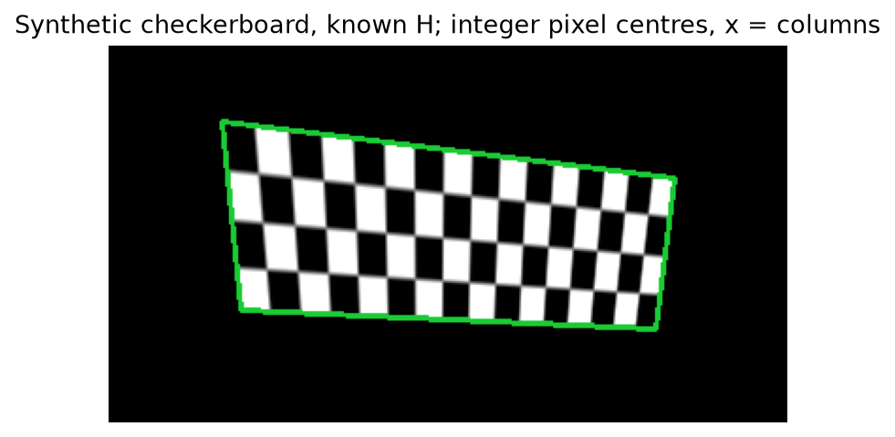

The synthetic checkerboard coverage spans x=60–300 and y=40–150, the target quadrilateral's bounds. Notebook 1 §8 also compares the student sampler with OpenCV inside coverage; interpolation differences at projective edges are not a coordinate-convention change. The permitted OpenCV baseline does not replace `warp_artwork`.

Utilities used are the supplied `sobel_gradients`, `gaussian_smooth`, `to_gray`, `rect_corners`, image/video loaders and plotting helpers; `rectangle_to_rectangle` supplies the pixel-centre rectangle scaling. Linear algebra uses NumPy SVD/inversion. Synthetic/GT transforms in the notebooks score correspondences only. The labelled SIFT and whole-frame-warp cells are comparisons, not assessed pipeline calls.

### Stress table (Stage 1)

| row | frames | median err | p90 err | success | inliers (median) | inlier ratio | affine median err | affine success |
|---|---|---|---|---|---|---|---|---|
| common · validation | 13 | 0.58% | 1.00% | 100% | 115 | 0.720 | 0.89% | 92% |
| common · test | 13 | 0.27% | 0.53% | 92% | 132 | 0.791 | 0.86% | 85% |
| viewpoint (coke_perspective) | 32 | 0.56% | 0.84% | 69% | 43 | 0.458 | 3.22% | 22% |
| scale (coke_scale) | 32 | 0.26% | 0.45% | 28% | 5 | 0.138 | 0.65% | 28% |

`localise_board` on every annotated frame with the frozen configuration; *affine* = 6-parameter least-squares fit to the same RANSAC inliers.

The generated table above is pasted unchanged from `outputs/stress_tables.md` (`--stages 1`, explicit frozen thresholds, full resolution). It measures independent `localise_board` predictions, not a flow-assisted video. Both success columns include all eligible annotated frames. Median/p90 errors describe finite estimates only. The following counts distinguish an unavailable model from an estimate outside the tolerance:

| Frozen independent localisation, 1280 px | Eligible frames | No model | Total failures at 2% |
|---|---:|---:|---:|
| common · validation | 13 | 0 | 0 |
| common · test | 13 | 1 | 1 |
| viewpoint (coke_perspective) | 32 | 10 | 10 |
| scale (coke_scale) | 32 | 23 | 23 |

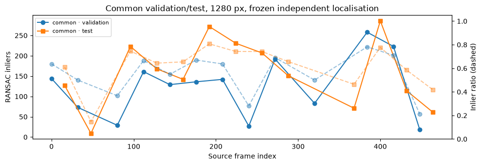

Dashed curves show the ratio of RANSAC inliers to accepted ratio-test matches. A high ratio alone does not establish correct board placement; corner error against annotations remains the placement measure.

#### Held-out estimator comparison and worst cases

On the 13 common **test** frames at 1280 px, RANSAC has finite median error 0.269%, p90 0.530%, and success 12/13. DLT on all of the **same ratio-test matches** has median 128.875%, p90 483.992%, and success 0/13. Outliers receive full influence in the all-match algebraic fit; the comparison changes only the estimator. This DLT baseline is the normalised homogeneous least-squares fit, not a nonlinear reprojection-error optimiser.

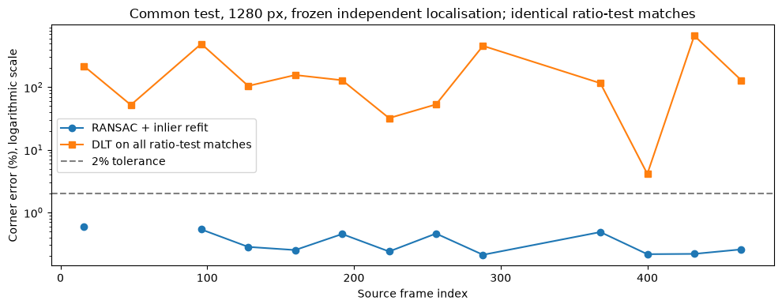

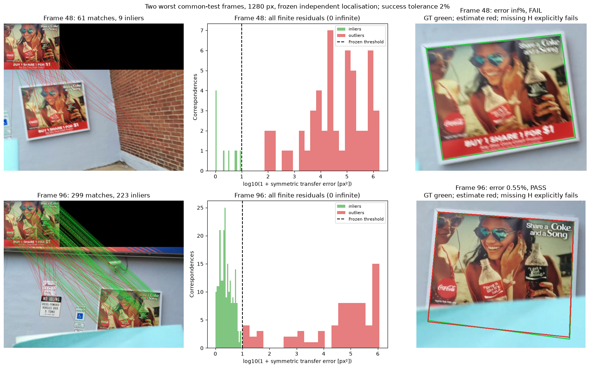

- Frame **48**: error unavailable (no model); fails 2%; 9/40 inliers, ratio 0.225, median RMS one-way residual 0.322 px, 2000 RANSAC iterations; model status False.
- Frame **16**: error 0.595%; passes 2%; 117/148 inliers, ratio 0.791, median RMS one-way residual 0.926 px, 29 RANSAC iterations; model status True.

Exactly **one common-test frame fails at 2%**; the other worst case passes. These are the two worst cases, selected after freezing; no method was damaged to create failures. Residual histograms use `log10(1 + e)` to show the full range, with `e` the symmetric transfer error in px² and the frozen 9 px² cutoff marked. The 2% decision is a separate, board-normalised corner measure.

Frame 48 shows substantial image blur and many inconsistent matches: the best candidate has only 9/40 inliers after the 2000-iteration cap, below the required 12. Its small 0.322 px inlier residual describes only that tiny consensus and cannot validate a board-wide homography; returning no model is appropriate. Frame 16 contains a large card occlusion, but 117/148 consistent matches remain on the visible texture. Its residual and corner error are nonzero, yet the estimate passes the frozen tolerance. These are different limitations: insufficient trustworthy correspondences versus imperfect but usable placement under partial occlusion.

### Question 1 — Matching

Notebook 1 §5 applies frozen settings to the viewpoint and scale clips at **640 px**. Rate means accepted matches divided by the method's own number of reference descriptors. It is not geometric precision, and these preview rates must not be confused with native-resolution success in the stress table.

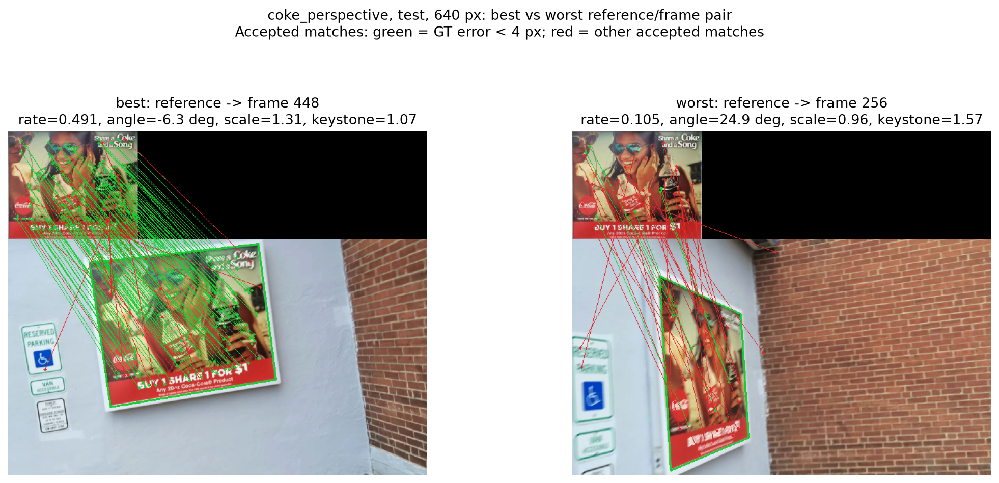

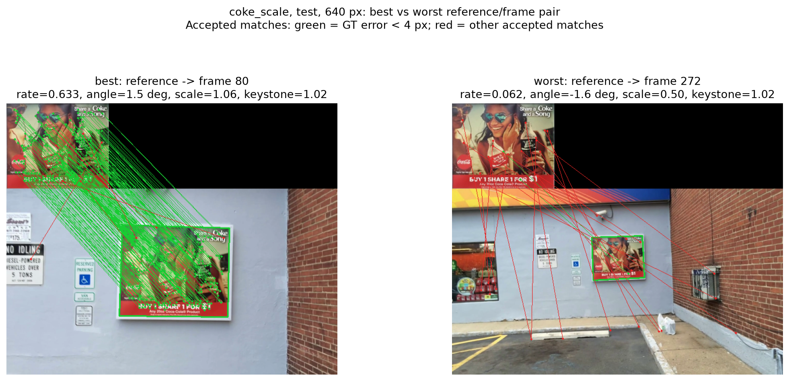

| Test clip, 640 px | Case/frame | Top-edge angle | Apparent scale | Keystone proxy | Harris reference/frame descriptors | Harris matches/rate | SIFT reference/frame descriptors | SIFT matches/rate |
|---|---|---:|---:|---:|---:|---:|---:|---:|
| coke_perspective | best / 400 | 3.0° | 1.280 | 1.286 | 280/624 | 141 / 0.504 | 470/1886 | 272 / 0.579 |
| coke_perspective | worst / 320 | 22.0° | 0.809 | 1.485 | 280/355 | 22 / 0.079 | 470/820 | 43 / 0.091 |
| coke_scale | best / 80 | 1.5° | 1.060 | 1.015 | 280/772 | 184 / 0.657 | 470/1485 | 296 / 0.630 |
| coke_scale | worst / 336 | -2.1° | 0.439 | 1.024 | 280/781 | 13 / 0.046 | 470/1645 | 87 / 0.185 |

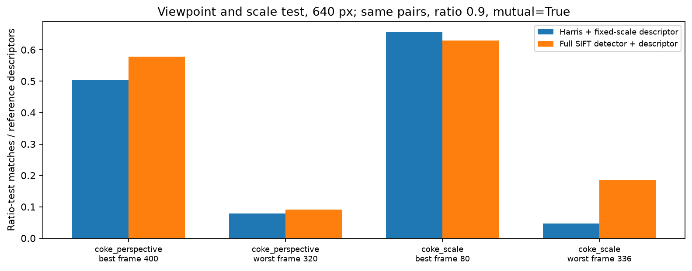

For the viewpoint pair, Harris matching falls from **141/280 (50.4%) on frame 400** to **22/280 (7.86%) on frame 320**, while the keystone proxy increases from 1.286 to 1.485. For the scale pair, it falls from **184/280 (65.7%) on frame 80** to **13/280 (4.64%) on frame 336**. Apparent scale falls from 1.060 to 0.439 while the top-edge angle stays close to horizontal (1.5° versus −2.1°), isolating size change more clearly than rotation. On the small-board frame, SIFT retains **87/470 (18.5%)**, compared with Harris **13/280 (4.64%)**. On the strongest matching-collapse viewpoint example, SIFT is also weak (**43/470, 9.15%**): scale selection does not undo general viewpoint deformation.

The descriptor rotates its sampling grid and subtracts the dominant orientation, absorbing approximate **in-plane rotation**. It does not adapt its 16 × 16 support to image scale or undo spatially varying perspective deformation. Under scale change, the same physical texture occupies different histogram cells and the fixed patch covers different structures; under viewpoint change, foreshortening, shear and keystone alter both cell occupancy and gradient orientations beyond one global rotation. Detector repeatability, blur and quantised orientation assignment also prevent perfect invariance.

Apparent scale is the square root of projected board area divided by reference area; it includes foreshortening and does not isolate camera distance. Keystone is the maximum opposite-edge length ratio, a perspective-asymmetry proxy rather than a complete projective-distortion measure. Full SIFT selects feature scale as well as orientation, so it can tolerate size changes that the fixed-support descriptor cannot. It is not fully perspective invariant. The baseline changes detector and descriptor together, and the rate denominators differ; it does not isolate descriptor scale normalisation alone. Both methods use ratio 0.90 and mutual matching in this comparison.

The native scale row tests this limitation with a **fixed reference size and unchanged settings**: moving the board away does not cause the implementation to resize the reference to each observed board. Only **9/32 scale frames (28%)** localise successfully, with **23 unavailable models**. The finite median of 0.26% describes only the nine recovered frames. These failures are transfer limitations; we do not repair them with scale-specific settings chosen on this test clip.

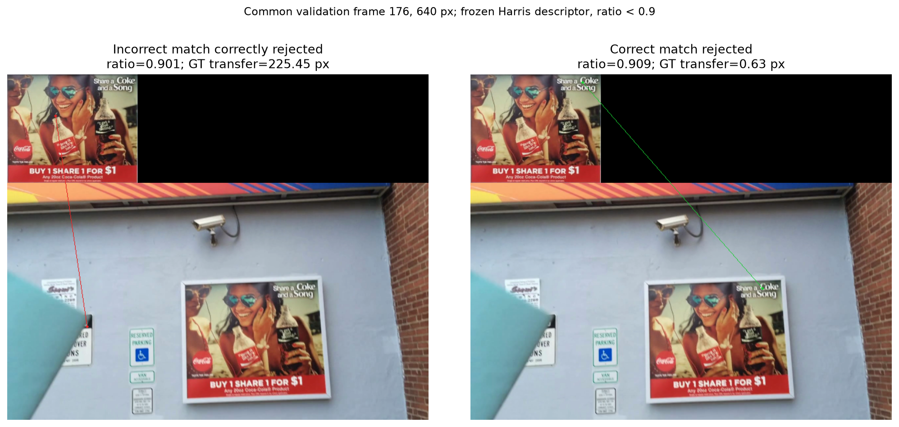

- Incorrect match correctly rejected on common validation frame 176 (640 px): descriptor indices [237, 80], ratio 0.901, GT-scored transfer distance 225.45 px.
- Correct match rejected on common validation frame 176 (640 px): descriptor indices [53, 52], ratio 0.909, GT-scored transfer distance 0.63 px.

These labels use <4 px one-way transfer only to analyse nearest neighbours. The ratio test measures descriptor distinctiveness, not geometry: near-duplicate letters/edges can make the best and second-best descriptors similarly close, including when the nearest neighbour is geometrically correct. Mutual matching separately rejects inconsistent reverse assignments. Ground truth labels these examples; it never chooses pipeline matches.

### Question 2 — Geometry

An affine map has six parameters and a constant 2 × 2 linear part: it maps a rectangle to a parallelogram and preserves parallel opposite edges. As the camera translates and rotates around the poster, distance varies across the board and opposite edges converge. A homography's eight degrees of freedom and position-dependent homogeneous denominator represent that keystone. The native viewpoint table compares both models on the **same RANSAC inlier correspondences**; it does not give the homography more favourable matches. The native viewpoint row gives homography median error **0.56%** versus affine **3.22%**, with success **22/32** versus **7/32**, respectively. The homography therefore models the orbit more accurately when correspondences remain available, but it does not cure the ten viewpoint localisation failures.

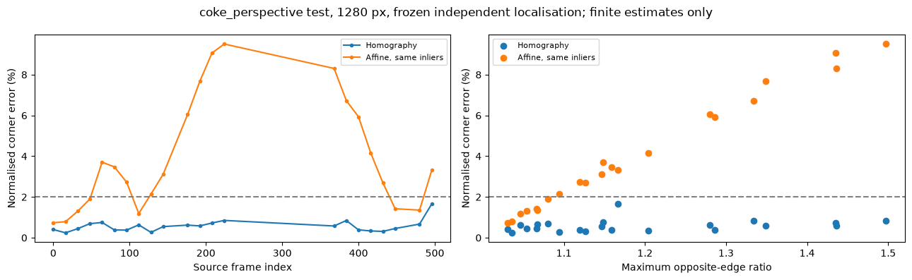

The representative native viewpoint frame **224** has homography error **0.850%** versus affine error **9.504%**, using identical inliers. Failed localisation frames count as failures for both models; the scatter contains finite estimates only. Keystone explains a trend, but local feature coverage and fit noise also affect corner error, so the relationship need not be monotonic.

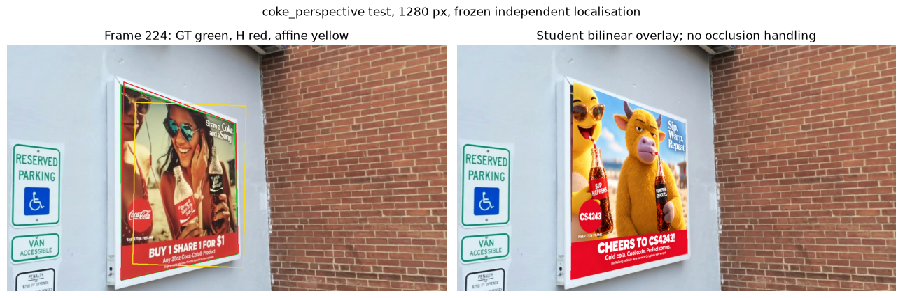

For the **640-pixel viewpoint test demonstration**, frame **0** is warped toward frame **224** by `H_b @ inverse(H_a)`, using estimated reference-to-frame homographies, not ground-truth initialisation.

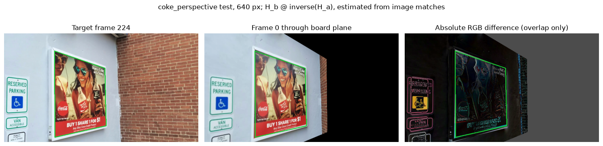

The board is approximately aligned while scene structures at other depths shift. With camera translation, the board-plane transform is exact only for that plane; off-plane points have different depth-dependent motion, producing parallax. The difference panel is restricted to valid source overlap; gray unobserved borders are not parallax. Within overlap it also contains interpolation, lighting and estimation error, so not every bright pixel is pure parallax.

This does not harm the overlay because `warp_artwork` samples the artwork only inside projected board coverage and `overlay_frame` copies the original frame elsewhere. The demonstration's whole-frame warp is a labelled comparison, not the rendering method. A **curved/folded or otherwise nonplanar board filmed under camera translation** would place target texture at different depths, so one homography would no longer anchor the complete advertisement correctly. Foreground occlusion is a separate issue handled in Stage 3.

## Stage 2 — Track
### Code Explanation

#### `temporal.py`

- `lk_flow`:
  - Builds a square window around each input point and samples the previous frame and its supplied Sobel gradients at the window coordinates. The mean gradient products form a normalised structure tensor; its two eigenvalues measure whether motion is observable in both image directions.
  - Iteratively samples the next frame at the displaced window, solves the two-dimensional Lucas–Kanade update, and stops when the update falls below the configured convergence limit or the iteration limit is reached. It returns a displacement and a mean absolute brightness residual for each point.
  - Marks points invalid when their window leaves either image, the smaller eigenvalue is below the configured minimum, the update does not converge, or the final residual exceeds its limit. The assessed implementation uses the required single-level flow; a pyramid is optional.

- `track_board`:
  - In the independent variant, calls `localise_board` on every frame using the reference image. Each frame receives its own homography, projected corners, status, and monitor statistics.
  - In the flow-assisted variant, localises the first frame and propagates its inlier reference-to-frame correspondences with `lk_flow`. It drops invalid tracks, fits a new homography with RANSAC, and retains the new inlier correspondences for the next frame. The optional corners mode instead propagates four projected corners and requires compatible minimum-point and inlier settings.
  - Re-localises when too few valid points remain, at the configured interval, after a failed homography estimate, or following a monitor warning. Each localiser call is recorded in `reinit_frames`; flow vectors, eigenvalues, residuals, and validity flags are exposed on frames tracked by flow. Frames with no usable model have `lost` status and NaN corners.
  - Builds per-frame statistics with the supplied helper. For flow frames, the inlier ratio is the RANSAC inlier count divided by the number of valid propagated points. The median residual is `median(sqrt(symmetric_transfer_error / 2))` over inliers, combining the forward and backward transfer errors in pixels.

- `failure_monitor`:
  - Assigns `HIDE` with trigger `no_model` when tracking has no usable model. Otherwise, too few inliers or a low inlier ratio requests `REINIT`, escalating to `HIDE` after the configured number of consecutive weak frames. Frames with no usable model also count towards this run.
  - If inlier checks pass, resets the consecutive weak-frame count and examines median residual, projected-corner displacement, mean flow, and brightness change in that order. The first finite statistic above its configured maximum triggers `REINIT`; otherwise the frame is `OK`. NaN statistics do not trigger a warning.

### Stress table (Stage 2)
### Question 3 — Tracking

## Stage 3 — Composite
### Code Explanation

#### `compositing.py`

- `hysteresis`:
  - Validates that the strong and weak masks are two-dimensional and have the same shape, and that connectivity is four or eight.
  - Starts a queue at every strong pixel and visits neighbouring weak pixels until no reachable pixels remain. It returns the reached Boolean mask, leaving disconnected weak responses out.

- `compensated_difference`:
  - Within the warped reference's coverage, ranks pixels by their raw mean absolute colour difference and selects the configured best-agreeing fraction for a shared gain-and-offset fit across RGB channels.
  - Computes the mean absolute colour difference between each covered frame pixel and its gain-and-offset-compensated reference value. It returns a zero-valued map outside coverage, the fitted gain and offset, and an identity fit if coverage is empty.

- `occlusion_mask`:
  - Warps the rectified board reference into the frame with the reference-to-frame homography, then obtains the compensated colour difference inside its coverage.
  - Applies the configured strong and weak thresholds with `hysteresis`, opens the candidate mask with a disc-shaped kernel, and retains connected components meeting `min_area`. The returned mask remains inside board coverage; the difference map and each kept component's label, bounds, and area are returned for diagnosis.

- `select_difference_thresholds`:
  - Precomputes the compensated difference for each supplied frame and searches strong and weak thresholds and minimum component areas. It scores each setting by the mean mask IoU against the supplied validation masks and returns the selected configuration and a log of the candidate scores.
  - Treats scores within an absolute tolerance of `1e-12` of the best score as tied, with zero relative tolerance. Selects the strong threshold nearest the midpoint between the smallest and largest tied strong values, so repeated weak/area combinations do not bias that midpoint. Then favours weak and area values nearest the input configuration, with the smaller strong value as a final tie-breaker.

- `composite`:
  - Forms a visible-board mask from artwork coverage minus occlusion. With feathering enabled, a distance transform reduces alpha near visible-region boundaries; with feathering disabled, alpha is exactly one on visible board pixels and zero elsewhere.
  - Optionally fits a shared gain and offset to the visible artwork and frame pixels, then blends the artwork and original frame with the alpha map. It returns an RGB float32 frame and an alpha map bounded by zero and one.

### Stress table (Stage 3)
### Question 4 — Occlusion

## Stage 4 — Your clip
### Capture and audit
### Overlay Scorecard
### Generative comparison
### Question 5 — Reflection

## Evidence table
| Student file | Function | Report section | Notebook figure / table / video |
|---|---|---|---|
| keypoints.py | harris_response, detect_corners, describe_keypoints, match_descriptors | Stage 1 — Code Explanation; Validation choices; Question 1 | Notebook 1 §§3–5 and SIFT cell; ratio_rejections.png; matching_coke_*.png; sift_comparison.png |
| geometry.py | bilinear_sample, normalise_points, dlt_homography, symmetric_transfer_error, ransac_homography, transfer_points, warp_artwork | Stage 1 — Code Explanation; Coordinate conventions; Estimator comparison; Question 2 | Notebook 1 §§6–8 (executed sanity checks); Notebook 2 §§4–6.1; warp_convention.png; native_worst_cases.png; native_ransac_vs_all.png |
| localisation.py | localise_board, artwork_to_frame, overlay_frame, evaluate_audit_frames | Stage 1 — Code Explanation; Validation choices; Stress table; Questions 1–2 | Notebook 2 §§2–6.1; native_inliers.png; native_viewpoint_overlay.png; outputs/stress_tables.md |
| temporal.py | lk_flow, track_board, failure_monitor | | |
| compositing.py | hysteresis, compensated_difference, occlusion_mask, select_difference_thresholds, composite | | |

## AI-use disclosure table
| Tool / model | Affected artefacts (file, cell, figure, section) | Markers | What the tool contributed | How it was verified |
|---|---|---|---|---|
| | | [AI-CODE] [AI-DESIGN] [AI-VISION] [AI-GENERATION] [AI-LANGUAGE] [HUMAN-DATA] [HUMAN-CHECK] | | |
